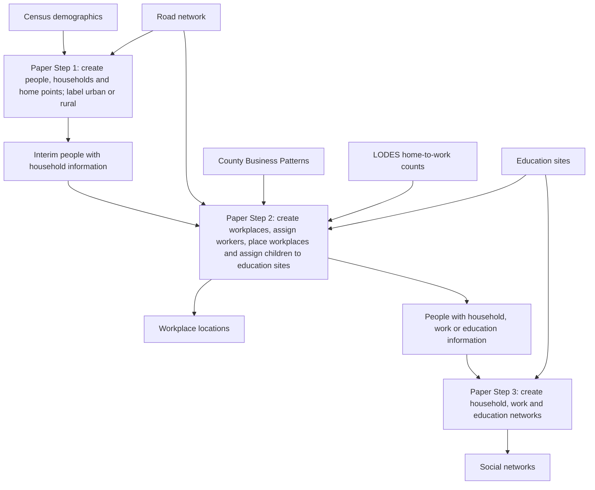

# Large-Scale Geographically Explicit Synthetic Population with Social Bonds Estimations for the United States

Python 3.12 research code for constructing a synthetic population for the 50 US states and Washington, D.C., with geographically located households and modeled household, workplace, school, and daycare connections.

A **synthetic population** consists of artificial people assembled to match selected demographic statistics. People, household memberships, home points, and social ties are generated; they are not identified residents or observed friendship records.

- **Original study:** [Scientific Data article](https://www.nature.com/articles/s41597-024-03970-1).
- **Published outputs:** [OSF datasets](https://osf.io/fpnc2/). The original repository reports 85 GB uncompressed nationally, distributed by state; check release documentation before downloading.
- **Fork scope:** document the existing implementation and its assumptions. Research extensions belong in a separate fork.

Code links below establish what the implementation does, not why a modeling choice is empirically justified. References to the [original paper](https://doi.org/10.1038/s41597-024-03970-1) identify its stated assumptions and rationale; page numbers refer to the published PDF. Census and software-documentation links provide definitions and API behavior. Where the paper and code differ, both are described rather than treating them as interchangeable.

## Contents

- [Modeling assumptions](#modeling-assumptions)
- [Modeling and validation gaps](#modeling-and-validation-gaps)
- [Workflow and repository map](#workflow-and-repository-map)
- [0. Preprocessing](#0-preprocessing)
    - [Census geography and demographic inputs](#census-geography-and-demographic-inputs)
    - [Road inputs](#road-inputs)
    - [Employment inputs](#employment-inputs)
        - [Compile home-to-work counts](#compile-home-to-work-counts)
        - [Estimate workplace counts](#estimate-workplace-counts)
    - [Education inputs](#education-inputs)
    - [Input paths](#input-paths)
- [1. Population synthesis](#1-population-synthesis)
    - [Ages and sex categories](#ages-and-sex-categories)
    - [Household membership](#household-membership)
        - [Household category targets](#household-category-targets)
        - [Member-selection order and partners](#member-selection-order-and-partners)
        - [Requested child and roommate counts](#requested-child-and-roommate-counts)
        - [Group quarters](#group-quarters)
        - [Remaining people](#remaining-people)
    - [Employment assignment](#employment-assignment)
    - [Road placement](#road-placement)
        - [Road classes and candidate points](#road-classes-and-candidate-points)
        - [Placement assumptions and limitations](#placement-assumptions-and-limitations)
    - [Education assignment](#education-assignment)
- [Population and workplace outputs](#population-and-workplace-outputs)
- [2. Social-network generation](#2-social-network-generation)
- [3. Validation methods](#3-validation-methods)
    - [Methods reported in the paper](#methods-reported-in-the-paper)
    - [Demographic and household checks](#demographic-and-household-checks)
    - [External comparisons](#external-comparisons)
    - [Coverage and interpretation](#coverage-and-interpretation)
- [Development environment and execution notes](#development-environment-and-execution-notes)
- [Setup and file-handoff gaps](#setup-and-file-handoff-gaps)
- [License and attribution](#license-and-attribution)

## Modeling assumptions

These are rules the code uses to build an artificial population. They describe how the model works, not verified facts about every real household. Separate limitations and paper/code differences follow in [modeling and validation gaps](#modeling-and-validation-gaps).

| Topic | Rule in plain language | Evidence |
| --- | --- | --- |
| Age within a five-year group | If Census data report 12 males aged 10–14, the code creates 2 aged 10, 2 aged 11, 2 aged 12, 2 aged 13, and 4 aged 14. The total stays 12; those exact ages are generated, not observed. | [Individual generator](src/ctreate_individuals.py#L17) |
| Sex categories | People receive the Census categories `m` or `f`; gender identity is not represented. | [Individual generator](src/ctreate_individuals.py#L26) |
| Household membership | Household types are filled in a fixed order. Members are selected from generated people in the tract, rather than reconstructed from actual families. | [Household coordinator](src/assign_household.py#L9) |
| Partners | Select a male aged 20+ first. At ages 20–25, select a female aged 18 through his age +15. For older males, use his age −5 through his age +15; if none is available, try any unassigned female aged 20+. Same-sex couples are not generated. | [Partner selection](src/assign_household.py#L291) |
| Requested children | For couples with children, the random number is centered at **2**; for single-parent categories, at **1.6**. Its standard deviation is 1. After converting to a positive whole number, at least one child is requested. | [Member selection](src/assign_household.py#L350), [count explanation](#requested-child-and-roommate-counts) |
| Child shortages and roommates | If too few children meet the age rule, the code can select unassigned adults instead. Later assignments of unassigned adults can increase household sizes. | [Member/fallback helpers](src/assign_household.py#L350) |
| Group quarters | All modeled group-quarters residents in a tract share **one synthetic household ID**, even if real residents live in different dormitories or institutions. Census resident counts are retained as targets; the number and identities of real facilities are not reconstructed. | [Paper, Step 1, p. 3](https://doi.org/10.1038/s41597-024-03970-1), [helper](src/assign_household.py#L480) |
| One job per selected adult | Each selected adult aged 18+ gets **one workplace ID at most**. The source LODES “all jobs” counts can include multiple jobs per real worker, but this model does not give a person multiple jobs. | [Work assignment](src/assign_workplace.py#L33), [LODES specification](https://lehd.ces.census.gov/data/lodes/LODES8/LODESTechDoc8.0.pdf) |
| Employment eligibility | Adults are selected without using retirement, labor-force participation, occupation, or income. Someone aged 65+ can be selected; someone aged 18–64 is not guaranteed a job. | [Adult selection](src/assign_workplace.py#L44) |
| Workplace selection | After choosing a work tract, select a synthetic workplace using supplied workplace probabilities. A helper creates probabilities from a lognormal distribution, allowing unequal workplace sizes. | [Probability helper](src/tools.py#L106), [workplace selection](src/assign_workplace.py#L71) |
| Home and workplace locations | Points on selected roads stand in for building locations. Different IDs may share a point. The authors give movement modeling and privacy as reasons for road-based placement. | [Paper, Steps 1–2, pp. 3–4](https://doi.org/10.1038/s41597-024-03970-1), [location generators](src/create_space.py#L34) |
| Transport conditions | Workplace assignment uses aggregate home/work-area counts, **not calculated travel distances or times**. Construction, closures, congestion, and detours are not modeled. Road geometry is used for placing locations, not planning commutes. | [Work assignment inputs](src/assign_workplace.py#L5), [location generators](src/create_space.py#L34) |
| Education participation | All children aged 0–4 are assigned to daycare and all aged 5–17 to school. Schools are selected using age and proximity rules. | [Paper, Step 2, p. 4](https://doi.org/10.1038/s41597-024-03970-1), [age branches](src/assign_education_site.py#L22) |
| Urban classification | The home is labeled `True` if its point intersects an urban-area polygon and `False` otherwise. | [`check_urban`](src/tools.py#L454) |
| Social ties | Everyone in groups of five or fewer is connected to everyone else. Larger groups receive a small-world network with mainly local links and some shortcuts. Ties are undirected and have no explicit weights. | [Paper, Step 3, refs. 26–27](https://doi.org/10.1038/s41597-024-03970-1), [edge generation](src/create_social_networks.py#L8) |

## Modeling and validation gaps

These are simplifications, differences, or missing checks that affect interpretation. Installation and file-format problems are listed separately under [setup and file-handoff gaps](#setup-and-file-handoff-gaps).

| Gap | Why it matters | Evidence |
| --- | --- | --- |
| Ages 90+ disappear as exact ages | Everyone in the Census “85 and older” category is reassigned an age from 85 to 89. The population count stays the same, but the oldest ages are not preserved. | [Age generator](src/ctreate_individuals.py#L28) |
| Partner ages differ between paper and code | For a male aged 35, the paper's main rule permits females aged 20–40, while the code initially permits 30–50. Single-parent upper-age rules differ too. | [Paper, Table 2](https://doi.org/10.1038/s41597-024-03970-1), [partner details](#member-selection-order-and-partners) |
| Requested family composition is not guaranteed | Child shortages can lead to adult replacements, and leftover assignments alter household sizes. No direct parent/child or spouse IDs are saved. | [Household code](src/assign_household.py#L350) |
| School/daycare sites can exceed enrollment | The code checks a supplied site count against enrollment but does not add one after assigning a child. It can also select a site that fails that check. It therefore does not ensure enough remaining places for all assigned children. | [Site selection](src/assign_education_site.py#L95) |
| Road placement differs from the paper | The paper describes 50 m home spacing, 20 m workplace spacing, and workplace candidates at road intersections. The code uses degree-based intervals for longitude/latitude inputs and local-road endpoints. | [Paper, Steps 1–2](https://doi.org/10.1038/s41597-024-03970-1), [placement code](src/create_space.py#L34) |
| Primary-road comments do not match the filter | Comments mention primary roads, but the workplace filter selects `S1200` secondary roads. The paper also describes secondary roads; primary-road exclusion is a code/comment discrepancy, not a claim that the paper requires primary roads. | [Workplace road filter](src/create_space.py#L91), [paper Step 2](https://doi.org/10.1038/s41597-024-03970-1) |
| Repeat runs need not reproduce the same assignments | The state driver fixes Python's random sequence but not NumPy's. Rerunning with the same inputs can change households, work assignments, and locations. Without controlling both sequences, a result may change because a different artificial population was generated, rather than because of the model change being studied. | [Seed setting](code/1-population-synthesis/run-synthesis-by-state.py#L109), [NumPy draws](src/assign_household.py#L365) |
| Realistic relationships are not directly validated | The available checks compare demographic/household totals and spatial population patterns. They do not compare generated ties with observed friendships, actual families, or observed socioeconomic mobility. | [Validation summary](#3-validation-methods) |
| Some attributes are absent | The population is a snapshot with no assigned income, wealth, or longitudinal mobility history. | [Synthesis steps](code/1-population-synthesis/run-synthesis-by-state.py#L72) |

## Workflow and repository map



This diagram follows the **three generation steps in [Figure 1, p. 2 of the paper](https://doi.org/10.1038/s41597-024-03970-1)**. The previous overview compressed those steps and added preprocessing/validation, which obscured the correspondence. It did not indicate a different generation method.

The repository groups work differently: `code/0-preprocess` prepares inputs; **paper Steps 1 and 2 both run in `code/1-population-synthesis`**; paper Step 3 runs in `code/2-social-networks`; `code/3-validation` evaluates the results. The README's numbered sections follow those folders. At a finer level, the driver calculates the urban flag after education assignment, while Figure 1 puts it in Step 1 ([driver order](code/1-population-synthesis/run-synthesis-by-state.py#L72)).


| Location | Purpose | Main entry points |
| --- | --- | --- |
| [`code/0-preprocess/`](code/0-preprocess/) | Prepare census boundaries and demographic tables, roads, commuting flows, and workplace counts. Some inputs must be supplied separately. | `prepare-census/`, `prepare-road/`, `prepare-commute-data/` |
| [`code/1-population-synthesis/`](code/1-population-synthesis/) | Coordinate population generation by tract and state. | [`run-synthesis-by-state.py`](code/1-population-synthesis/run-synthesis-by-state.py) |
| [`code/2-social-networks/`](code/2-social-networks/) | Build household/education networks and collect workers for a national workplace network. | [`create_edu_hhold_get_work_pop.py`](code/2-social-networks/create_edu_hhold_get_work_pop.py), [`create_work_networks.py`](code/2-social-networks/create_work_networks.py) |
| [`code/3-validation/`](code/3-validation/) | Compare generated demographics, household characteristics, and geographic population counts with reference data. | `validation_population.py`, `validation_hhold.py`, and external validation scripts |
| [`src/`](src/) | Reusable functions called by the scripts above. | See the table below. |
| [`Figures/`](Figures/) | Original project illustrations. | `workflow.png`, `social_nw.png` |

The numbered folders indicate the intended processing stages. The current checkout has handoff gaps, so running every script in numerical order is not a verified end-to-end recipe.

## 0. Preprocessing

### Census geography and demographic inputs

A **[census tract](https://www.census.gov/programs-surveys/geography/about/glossary.html)** is a relatively permanent statistical subdivision of a county. Tracts generally contain 1,200–8,000 people, with a target around 4,000, but can have fewer or no residents. Their land areas vary; they are not necessarily neighborhoods or cities.

**[Census blocks](https://www.census.gov/programs-surveys/geography/about/glossary.html)** are the smaller units inside tracts. They have no fixed acreage or population size: one may resemble a city block, while a rural block can cover many square miles, and some are unpopulated. Roads, waterways, other features, and legal boundaries can define their edges. Do not treat a block as a fixed walking distance.

A full tract identifier has 11 digits: state (2), county (3), tract (6). A block adds four digits, for 15 total. Keep leading zeros. Sources: [Census geographic identifiers](https://www.census.gov/programs-surveys/geography/guidance/geo-identifiers.html) and [LODES technical documentation](https://lehd.ces.census.gov/data/lodes/LODES8/LODESTechDoc8.0.pdf).

[`download_census_shp.py`](code/0-preprocess/prepare-census/download_census_shp.py) uses helpers to fetch [2020 TIGER/Line tract boundaries](https://www2.census.gov/geo/tiger/TIGER2020/TRACT/). [`process_census_shp.py`](code/0-preprocess/prepare-census/process_census_shp.py) reads a supplied 2020 Demographic Profile CSV, extracts age/sex and household fields, and joins them to tract geography by `GEOID`. Some later helpers select columns by position; preserve the expected field order as well as names.

The paper's [Table 1 and references 21/35](https://doi.org/10.1038/s41597-024-03970-1) identify these sources as the [2020 Census Demographic Profile](https://www.census.gov/data/tables/2023/dec/2020-census-demographic-profile.html) and 2020 tract boundaries. Its reference 22 also identifies [2020 TIGER/Line urban-area boundaries](https://www.census.gov/cgi-bin/geo/shapefiles/index.php?year=2020&layergroup=Urban+Areas), used later for the urban flag.

[`src/settings.py`](src/settings.py) lists 51 areas: 50 states plus Washington, D.C. Its nonconsecutive geographic codes are identifiers, not entry counts ([Census ANSI/FIPS reference](https://www.census.gov/library/reference/code-lists/ansi.html)).

### Road inputs

The road-download helper points to the **US Census Bureau's [2020 TIGER/Line All Roads files](https://www2.census.gov/geo/tiger/TIGER2020/ROADS/)**, consistent with [paper Table 1 and reference 25](https://doi.org/10.1038/s41597-024-03970-1). These geographic files contain road-line geometry and attributes such as road identifiers and classification codes. They describe roads, not public-transit schedules or observed trips.

`richard_download_and_prepare_road_data` in [`src/preprocess_data.py`](src/preprocess_data.py) selects county ZIP files matching the state's geographic code, downloads them, and combines them into an intermediate state road file. [`clean_raod_with_grass.py`](code/0-preprocess/prepare-road/clean_raod_with_grass.py) specifies GRASS GIS cleaning operations to snap nearby vertices, split line crossings, remove duplicate features, and remove small angles. `process_interim_road_data` then packages the cleaned geometry, road identifiers (`LINEARID`), classification (`MTFCC`), and connected-component information as `<STATE>_road_cleaned.shp.zip` for synthesis. GRASS GIS is geographic-processing software; connected components identify groups of road segments connected to one another.

Sources: the [download/preparation helpers](src/preprocess_data.py#L170) and [GRASS cleaning commands](code/0-preprocess/prepare-road/clean_raod_with_grass.py#L38). This documents the intended code path; the published OSF files have not been independently checked against it. The synthesis uses these lines for placement, not travel-time estimation.

### Employment inputs

#### Compile home-to-work counts

[`process_lodes8.py`](code/0-preprocess/prepare-commute-data/process_lodes8.py) calls helpers to download 2020 **LODES** (LEHD Origin-Destination Employment Statistics). **Origin** is the home location; **destination** is the job location.

The paper identifies [2020 LODES 8 and County Business Patterns in Table 1, references 23–24](https://doi.org/10.1038/s41597-024-03970-1). Reference 23 links the [specific CBP source archive](https://www2.census.gov/programs-surveys/cbp/data/2020/CB2000CBP.zip).

Original records connect **home blocks to work blocks**, using `h_geocode` and `w_geocode`. `S000` (S followed by three zeros) counts jobs for that pair and selected job type. This code requests `JT00`, all jobs; one worker can hold multiple jobs, so job totals are not necessarily unique-person totals. These definitions come from the [Census LODES technical documentation](https://lehd.ces.census.gov/data/lodes/LODES8/LODESTechDoc8.0.pdf).

| File type requested | Contents relative to the work state | Example requested filename |
| --- | --- | --- |
| `main` | Home and work are in the same state. | `ut_od_main_JT00_2020.csv.gz` |
| `aux` | The job is in that state; the home is outside it. | `ut_od_aux_JT00_2020.csv.gz` |

The downloader builds these filenames and writes them under `data/raw-data/work_commute/`. A state's `aux` file covers incoming workers, not all of its residents' outgoing jobs. Source: [`download_lodes_2020_data`](src/preprocess_data.py#L545).

To aggregate, the helper replaces each block ID with its parent tract ID, then **adds job counts for identical home-tract/work-tract pairs**. It combines the downloaded files and writes `home`, `work`, and summed `S000` to `interim-data/od/<state>-tract-od-2020.csv`. The first 11 digits of a properly padded block ID identify its tract; the existing implementation has special handling for lost leading zeros. Source: [`combine_in_out_county_data`](src/preprocess_data.py#L586).

For example, after aggregation (A, B, and C stand in for tract IDs):

| `home` | `work` | `S000` | Meaning |
| --- | --- | --- | --- |
| A | B | 100 | There are 100 jobs in tract B held by people living in tract A. |
| A | C | 40 | There are 40 jobs in tract C held by people living in tract A. |

Each row is a total for an area pair, not an individual commute or a friendship. The assignment stage uses these totals to select work destinations for synthetic adults from A.

#### Estimate workplace counts

[`process_cbp.py`](code/0-preprocess/prepare-commute-data/process_cbp.py) reads a supplied 2020 **[County Business Patterns](https://www.census.gov/programs-surveys/cbp/about.html)** CSV. It selects all-industry/all-establishment-size rows and retains county IDs and `ESTAB`, the number of business establishments (business sites, not jobs). It writes `interim-data/cbp/workplace_cbp.csv`.

The intended rule in [`get_number_of_wp`](src/preprocess_data.py#L632) is to give a tract the same share of its county's establishments as its share of the county's jobs:

$$
\widehat{B}_t = \left\lfloor B_c \frac{J_t}{J_c} \right\rfloor .
$$

Here $t$ means the tract and $c$ its county. $B$ stands for the number of business establishments; the subscript in $B_t$ means ‘the number in tract $t$.’ The hat in $\widehat{B}_t$ means **an estimate**, rather than a directly observed count. $B_c$ is the county's establishment count, $J_t$ is jobs located in the tract, and $J_c$ is jobs located in that county. Thus the fraction is the tract's share of county jobs, and the brackets mean round down. For example, a tract with 10% of a county's jobs receives 10% of its 1,000 establishments: **100 synthetic workplaces**. This is an estimate, not observed business addresses.

**Implementation discrepancy:** the current helper takes the first grouped county job total, rather than looking up the tract's county total. The formula describes its intended allocation; the implementation needs correction or validation. [`add_tract_workplaces.py`](code/0-preprocess/prepare-commute-data/add_tract_workplaces.py) stores the result as `WP_CNT`.

The synthesis also requires national `us_tract_number_work.json` with `GEOID`, `WP_CNT`, and `WP_PROBA` (workplace-selection probabilities). [`wp_proba`](src/tools.py#L106) draws lognormal weights and normalizes them; its comments link workplace-size literature, but the complete JSON-building driver is absent. Also resolve the handoff from intermediate commuting output to the synthesis driver's `processed-data/od` input.

### Education inputs

The state driver loads `<state>_school_id.gpkg` and `<state>_daycare_id.gpkg`. [Paper Table 1, Step 2, and reference 20](https://doi.org/10.1038/s41597-024-03970-1) identify the source as the EPA's **[Educational Institutions, US, 2015, ORNL, SEGS](https://edg.epa.gov/metadata/catalog/search/resource/details.page?uuid=%7B9C49AE4B-F175-43D0-BCC6-A928FF54C329%7D)**, covering schools and daycare. Thus these inputs are dated 2015 while the demographic/commuting inputs are dated 2020. The paper says unique site IDs were added during preprocessing. The checkout does not include a complete script reproducing the preparation of these GeoPackages, and the published files have not been inspected here.

| Input field | How the assignment code uses it |
| --- | --- |
| `eduID` | Identifier copied into a child's `wp` field. |
| `geometry` | Site location used to search around the home tract. |
| `LATITUDE`, `LONGITUDE` | Site coordinates used to rank candidates by distance from the child's home. |
| `s_age`, `e_age` | Inclusive minimum and maximum ages accepted by a school. The daycare branch does not apply this filter. |
| `ENROLLMENT` | Supplied enrollment value used as an upper bound in the eligibility comparison. It is not verified building capacity. |
| `count` | Supplied count compared with `ENROLLMENT`; its initialization/provenance is not shown, and this assignment module does not increment it when placing a child. |

The school-age helpers in `src/preprocess_data.py` map school `LEVEL` to ages: Primary/Elementary 5–11, Middle 12–14, Secondary 12–17, High 15–17, and other levels 5–17. These helpers exist, but no complete preparation driver invoking them is supplied.

Sources: [state input loading](code/1-population-synthesis/run-synthesis-by-state.py#L152), [school age-range helpers](src/preprocess_data.py#L719), and [assignment field access](src/assign_education_site.py#L32). School and daycare use separate tables but share the same assignment module.

### Input paths

The data are distributed separately from this checkout. Paths in [`src/settings.py`](src/settings.py) are relative to the process's working directory; some drivers instead hardcode `../../data/...`.

```text
data/
  raw-data/          # Original census, commuting and other source inputs
  interim-data/      # Intermediate preparation outputs
  processed-data/   # Inputs consumed by population synthesis
    census/
    od/
    road/
    edu/
    urban/
    us_tract_number_work.json
  results-data/     # Generated population, workplace and network outputs
    <state>/
    1-us/           # National worker table and work network
```

For each state, the synthesis driver expects the following names. Here `<state>` is its lowercase abbreviation and `<STATE>` its uppercase abbreviation. These are **code expectations, not a verified OSF file inventory**:

```text
data/processed-data/census/<state>-tracts-demo-work.shp.zip
data/processed-data/od/<state>-tract-od-2020.csv
data/processed-data/road/<STATE>_road_cleaned.shp.zip
data/processed-data/edu/<state>_school_id.gpkg
data/processed-data/edu/<state>_daycare_id.gpkg
data/processed-data/urban/<STATE>_urban.gpkg
data/processed-data/us_tract_number_work.json
```

The JSON supplies national destination-tract workplace metadata, including `GEOID`, `WP_CNT`, and `WP_PROBA`, which support cross-tract and cross-state work assignments.

## 1. Population synthesis

[`run-synthesis-by-state.py`](code/1-population-synthesis/run-synthesis-by-state.py#L72) processes populated tracts: generate people, assign households, generate home points, assign work IDs and workplace points, assign education sites, set urban flags, and collect checks. The following sections follow that sequence.

| Module | Role |
| --- | --- |
| [`src/ctreate_individuals.py`](src/ctreate_individuals.py) | Generate [ages and sex categories](#ages-and-sex-categories). |
| [`src/assign_household.py`](src/assign_household.py) | Assign [household membership](#household-membership). |
| [`src/create_space.py`](src/create_space.py) | Generate [home and workplace points](#road-placement). |
| [`src/assign_workplace.py`](src/assign_workplace.py) | Use prepared [employment inputs](#employment-inputs) to [assign workers](#employment-assignment). |
| [`src/assign_education_site.py`](src/assign_education_site.py) | Use prepared [education inputs](#education-inputs) for [school/daycare assignment](#education-assignment). |
| [`src/tools.py`](src/tools.py) | Collect [output fields](#population-and-workplace-outputs), flag urban residence, and check counts. |

### Ages and sex categories

The input [Census DP1 age/sex counts](https://api.census.gov/data/2020/dec/dp/groups/DP1.json) already use age categories. [`__create_individuals__`](src/ctreate_individuals.py#L17) takes 18 groups for each of two sex categories and expands their counts into individual people. For example, if the Census reports 12 males aged 10–14, it creates the following people:

| Generated age | Number of people |
| --- | --- |
| 10 | 2 |
| 11 | 2 |
| 12 | 2 |
| 13 | 2 |
| 14 | 4 |
| **Total** | **12** |

The code first allocates two people to each of the five ages, then puts the two people left over at age 14. The source gives the total of 12, not those exact ages; the code chooses them using this rule.

Thus the grouped input is inherited from Census statistics, rather than the code observing every person's exact age. The implementation needs individual ages for household, adult-work, school, and daycare rules. The authors explain that they chose **hierarchical sampling** because it can use aggregate data without requiring individual microdata and is flexible and computationally efficient. They iterate over the 18 age groups per sex to match Census distributions ([paper Background & Summary, p. 2; Step 1, p. 3; references 18–19 and 21](https://doi.org/10.1038/s41597-024-03970-1)). This is the stated reason for the approach, not evidence for the code's particular choice of exact ages within each Census age group.

The last Census age category is **“85 years and over”**: it combines people aged 85, 86, 90, 100, and any older ages into one total. The code mistakenly treats that open-ended category as if it were the five-year range **85–89**. For example, if the source reports 50 people aged 85+, it generates ten aged 85, ten aged 86, ten aged 87, ten aged 88, and ten aged 89. It still generates 50 people, but none is aged 90 or older. This is a limitation of this implementation, not a statement about real longevity. Its `gender` field holds `m`/`f` census sex categories, not gender identity.

### Household membership

[`__assign_household_order__`](src/assign_household.py#L9) fills household-type targets with generated people from the same tract. It does not recover actual families or jointly fit household size, relationships, and socioeconomic attributes.

#### Household category targets

`__get_hhold_type__` reads columns from the **[2020 Census Demographic Profile table DP1](https://api.census.gov/data/2020/dec/dp/groups/DP1.json)**. A name such as `DP1_0133C` is a source-table field identifier, not a tunable model parameter: `DP1` identifies the table, `0133` the item, and `C` a count field. In Python, `tract.DP1_0133C` retrieves that field's value for the current tract.

Fields such as `DP1_0113C` follow this naming convention:

| Part | Meaning |
| --- | --- |
| `DP1` | The Census Demographic Profile table containing the statistic. |
| `_0113` | The item identifier within that table; it is a lookup key, not the number of people or households. |
| `C` | A count, rather than a percentage. The category being counted depends on the item. |

The full identifier is the column name in the input data. Its human-readable definition comes from the [Census DP1 variable metadata](https://api.census.gov/data/2020/dec/dp/groups/DP1.json), a dictionary of column names and labels. The category column below explains the household categories used by the code, while the formula column preserves the original Census field names so the calculation can be traced back to its inputs.

The **target-count formula** column below explains how many household slots to create from those input counts. For example, the code interprets `DP1_0133C` as all married-couple households and `DP1_0134C` as the subset with children, so their difference supplies the without-children target. Categories are described according to their interpretation in this code; verify the full source-table labels and definitions when preparing replacement inputs.

| `htype` | Category used by the code | Target-count formula using DP1 input columns |
| --- | --- | --- |
| 0 | Married couple without children | `DP1_0133C - DP1_0134C` |
| 1 | Married couple with children | `DP1_0134C` |
| 2 | Cohabiting couple without children | `DP1_0135C - DP1_0136C` |
| 3 | Cohabiting couple with children | `DP1_0136C` |
| 4 | Male living alone, under 65 | `DP1_0138C - DP1_0139C` |
| 5 | Male living alone, 65 or older | `DP1_0139C` |
| 6 | Male householder with children | `DP1_0140C` |
| 7 | Female living alone, under 65 | `DP1_0142C - DP1_0143C` |
| 8 | Female living alone, 65 or older | `DP1_0143C` |
| 9 | Female householder with children | `DP1_0144C` |
| 10 | Remaining non-family group category | `(DP1_0137C - DP1_0138C - DP1_0140C) + (DP1_0141C - DP1_0142C - DP1_0144C)` |

For example, if a tract has 100 married-couple households and 40 in the with-children category, the targets are 60 type-0 households and 40 type-1 households. These are household counts, not counts of people.

Source for the category calculations: [`__get_hhold_type__`](src/assign_household.py#L85).

#### Member-selection order and partners

[`__creat_hhold_id__`](src/assign_household.py#L167) creates household slots and fills types in the order **4, 5, 7, 8, 0, 1, 2, 3, 9, 10, 6**. Living-alone households select matching adults first; subsequent categories draw from those still unassigned.

For couples, [`__htype_find_members__`](src/assign_household.py#L291) selects a male aged 20+, then an unassigned female:

| Selected male's age $a$ | Initial female age range | Fallback implemented |
| --- | --- | --- |
| 20–25 | 18 through $a+15$ | No broader fallback in this branch; an empty pool can fail. |
| Over 25 | $a-5$ through $a+15$ | If empty, choose from all unassigned females aged **20 through the maximum age in the generated tract population**, inclusive. If this is empty too, selection can fail. |

A male aged 35 can therefore receive a female aged 30–50; males are not required to be older. Same-sex couples are not represented. **The paper differs:** [Table 2, p. 3](https://doi.org/10.1038/s41597-024-03970-1) states that, outside its 20–25 exception, husband's age minus wife's age is between −5 and +15. Algebraically that permits a female age of $a-15$ through $a+5$ (20–40 for a male aged 35), while the code uses $a-5$ through $a+15$ (30–50). Do not silently treat one as the other.

The code’s window allows a female partner to be up to 15 years older but only 5 years younger in the over-25 branch. This can favor older female partners. If the available pool had equal numbers at every age from 30 to 50, the mean female age for a male aged 35 would be 40. The actual available ages are not evenly distributed and earlier assignments remove candidates, so whether females are **usually** older must be measured from generated couples rather than assumed from the window.

Table 2 presents these as assignment assumptions, without attaching a prior-study citation to the specific age windows or documenting the broad female-adult fallback. The code itself also gives no citation for that fallback. A Census families link near child selection does not establish support for partner-age windows. For single-parent households, Table 2 specifies ages 18–64 while the code selects adults aged 18+ without that upper limit.

#### Requested child and roommate counts

The code draws a number, converts its magnitude to a whole count, and requires at least one:

$$
Z \sim \mathcal{N}(\mu,1^2), \qquad
K = \max\left\{1,\left\lfloor |Z| \right\rfloor\right\}.
$$

$Z$ is a normal (bell-shaped) random draw with mean $\mu$ and **standard deviation 1**. $|Z|$ makes it nonnegative; the floor brackets round down; the outer maximum enforces at least one. Draws 0.8, 2.7, and 3.4 request 1, 2, and 3 members. **The mean is not a maximum; there is no fixed upper cap.** The values below are the means of the initial random numbers. Rounding and the minimum of one change the average requested count, and candidate shortages or leftover allocation can change the final household average again.

For a simple illustration, five initial numbers **1.2, 1.6, 2.0, 2.4, 2.8** average exactly **2**. The code converts them to **1, 1, 2, 2, 2**, which average **1.6**. This illustrates why changing the numbers changes their average; it is not an estimate of the model’s overall mean. Child shortages, adult replacements, and later household assignments change final counts further. Also, these parameters apply only to the with-children categories, not to an average over all households, including those without children.

| Household rule | $\mu$ |
| --- | --- |
| Couple with children | 2 |
| Male/female householder with children | 1.6 |
| Additional members of a non-family group | 1.5 |

Child candidates have ages 0 through the smaller of 18 and the youngest selected parent's age minus 18, inclusive. If there are too few, the helper falls back to unassigned adults; later leftover allocation can also change household size. These are requested counts, not guaranteed final parent/child compositions. Sources: [member-count and fallback code](src/assign_household.py#L350), [NumPy normal-distribution parameters](https://numpy.org/doc/stable/reference/random/generated/numpy.random.normal.html). No verified empirical rationale is supplied here for the chosen means.

#### Group quarters

**[Group quarters](https://www.census.gov/programs-surveys/geography/about/glossary.html)** are communal living arrangements, such as dormitories, nursing facilities, or correctional institutions. `__get_group_quarter__` is the Python helper that selects people for this category.

The institutionalized and non-institutionalized **counts come from the 2020 Census DP1 tract data**, not from random draws. [`process_census_shp.py`](code/0-preprocess/prepare-census/process_census_shp.py) retains these columns from the input demographic-profile CSV and merges them with tract geography. Their counts are empirical inputs; choosing which synthetic people fill those counts is modeled. The initial age windows below are also code choices, not additional age breakdowns supplied by those four count fields.

After regular households have selected members, the group-quarters helper reads these four tract counts:

| DP1 column | Group interpreted by the code | Initial candidate ages |
| --- | --- | --- |
| `DP1_0127C` | Institutionalized males | 18–64 |
| `DP1_0128C` | Institutionalized females | 18–64 |
| `DP1_0130C` | Non-institutionalized males | 18–100 |
| `DP1_0131C` | Non-institutionalized females | 18–100 |

For each nonzero count, `__get_group_quarter_ids__` randomly selects that many remaining people matching the category's sex and initial age range, without reusing selected people. If that pool is too small, it tries all remaining people of the same sex regardless of age. If even that pool is too small, it returns an empty selection rather than a partial allocation.

**Yes: whenever group quarters are represented in a tract, their residents share one synthetic group-quarters household ID.** This does not mean that every tract has one real institution, or even has any group-quarters residents. It is an explicit modeling assumption: multiple real facilities are merged because the authors lack facility counts ([paper Step 1, p. 3](https://doi.org/10.1038/s41597-024-03970-1)). For example, residents of two dormitories and a nursing facility within one tract would share one modeled household ID, which can also connect them within the same synthetic household network.

The helper returns selected member lists with the shared ID `<tract>h<regular-household-count>` and category `htype=11`. The main assignment function gives those residents this ID; unselected people proceed to the leftover rules below.

**If the Census input says there are zero regular households:** the code uses a different path. It asks the group-quarters helper for an ID, then gives **every generated person in that tract** that same ID and category 11, instead of trying to form ordinary families. This could represent an institution-only tract. It is not applied to all tracts, and can fail if the helper returns no group-quarters row from which to obtain an ID ([special branch](src/assign_household.py#L22)).

Sources: [`__get_group_quarter__` and its selection helper](src/assign_household.py#L480); [Census DP1 definitions](https://api.census.gov/data/2020/dec/dp/groups/DP1.json).

#### Remaining people

`__assign_left_pop_hhold__` first makes a list of households allowed to receive the remaining person. Each household gets the fixed preference weight shown below. It then **divides each weight by the sum of all eligible households’ weights**, making the selection probabilities add up to 1. This is what “normalize” means here; it is not fitting probabilities to a Census distribution:

| Remaining person's age | Eligible household types | Relative weights per household |
| --- | --- | --- |
| Under 18 | 1, 3, 6, 9; fallback to 10 if none exist | 0.45 for 1/3; 0.1 for 6/9 |
| Exactly 18 | 1, 3, 10 | 0.2 for 1/3; 0.6 for 10 |
| Over 18 | 0, 1, 2, 3, 10 | 0.1 for 0/1/2/3; 0.6 for 10 |

For example, suppose a remaining child has only two eligible households: one type 1 with weight 0.45 and one type 6 with weight 0.10. The sum is 0.55, so their selection probabilities are **0.45 ÷ 0.55 ≈ 81.8%** and **0.10 ÷ 0.55 ≈ 18.2%**. More eligible households change that denominator. Census targets influence how many households exist, but the preference weights themselves are fixed in the code, not estimated from Census proportions. Adding these remaining people can change household sizes and composition.

The resulting `hhold` identifier records co-residence. It does not provide explicit parent/child or spouse identifiers for later intergenerational analysis.

After membership is assigned, everyone sharing a household ID receives the same generated home point. See [road placement](#road-placement) for how that point is selected; household composition and geographic placement are separate steps.

Source: [`__assign_left_pop_hhold__`](src/assign_household.py#L595).

### Employment assignment

[`__assign_workplaces__`](src/assign_workplace.py#L33) looks up job destinations for each home tract. Let **A** be the number of generated residents aged 18+, and **J** the total jobs assigned to that home tract in the commuting table:

- **If J is greater than A:** all A adults receive **one job each, not multiple jobs**. The code builds a list of destination tracts repeated according to job counts, then randomly selects A entries from that list. For 8 adults and 10 job entries, only 8 entries are assigned, one per adult; the excess 2 jobs are not assigned to anyone. Destinations with more entries are more likely to be selected.
- **If J is at most A:** randomly select J adults, then assign the J job entries among them. Other adults receive no job from this step.

The model therefore gives each adult **at most one workplace ID**, even when the source data count multiple jobs held by the same real person. It does not distinguish retired people, people looking for work, or adults outside the labor force; it samples from all generated adults aged 18+, without matching occupation or income. The source job counts limit how many assignments are made, but do not establish each selected person’s actual employment status.

[`generate_workplace_id`](src/assign_workplace.py#L71) then selects a synthetic workplace within the destination tract using `WP_CNT` and `WP_PROBA`, producing `<tract>w<number>`. Missing/zero metadata can produce `wNotFound`/`wNone` IDs, which require checking. Workplace ID assignment and [coordinate generation](#road-placement) are separate. **No road-network commute distance is calculated:** the work assignment uses home/work tract counts, while road geometry supplies possible work-site points. It does not account for construction sites, closures, congestion, detours, or route travel time. The historical commuting counts may reflect conditions when collected, but the model does not explicitly simulate those transport conditions.

### Road placement

The authors use road locations as proxies for buildings to support movement modeling and preserve some privacy ([paper Step 1, p. 3](https://doi.org/10.1038/s41597-024-03970-1)). The paper describes approximately 50-meter home spacing and 20-meter workplace spacing, including workplace locations at secondary/residential-road intersections. The implementation below instead uses coordinate-unit interpolation intervals and geometry endpoints; it neither guarantees those metric spacings nor calculates those intersections.

Both location functions in [`src/create_space.py`](src/create_space.py) use the prepared road dataset and a tract polygon. They select roads intersecting that tract, clip them to its boundary, retain supported line geometries, and remove duplicate coordinate sequences after rounding coordinates to six decimal places. The input `MTFCC` field is the Census **[MAF/TIGER Feature Class Code](https://www.census.gov/library/reference/code-lists/mt-feature-class-codes.html)**, identifying the type of road.

#### Road classes and candidate points

| Road code | Road category | Home candidates | Workplace candidates |
| --- | --- | --- | --- |
| `S1400` | Local neighborhood roads, rural roads, and city streets | Points sampled along the clipped road geometry. | The first coordinate of each clipped geometry. |
| `S1740` | Private roads for service vehicles, such as logging, oil-field, or ranch roads | Same treatment as `S1400`. | Same treatment as `S1400`. |
| `S1200` | Secondary roads | Not selected for homes. | Points sampled along the clipped road geometry. |
| `S1100` | Primary roads | Not selected. | Not selected by the implemented filter, despite comments mentioning primary roads. |

**Homes:** `__create_home_location__` generates candidate points at distance intervals of `0.0005` along the selected `S1400`/`S1740` geometries, starting at that interval and stopping before the geometry's end. It randomly samples from the pooled candidates. The state driver requests `DP1_0132C + 1` locations: one per regular household slot plus one for the tract's shared group-quarters ID. The returned points are indexed by household ID and mapped onto people's home `geometry` fields.

**Workplaces:** `__create_work_location__` generates candidates along `S1200` roads using intervals of `0.0002`, then adds the first coordinate from each selected `S1400`/`S1740` geometry. For a multi-part road, it uses the first coordinate of the first part. Although the variable is called `intersection_points`, the code does not calculate intersections between roads: these are geometry endpoints, which may also lie on the tract boundary after clipping. It samples `WP_CNT` points from the combined pool; local/private-road endpoints can supply locations when secondary-road candidates are unavailable. Points are indexed by workplace ID and saved in the workplace table, separate from people's home coordinates.

#### Placement assumptions and limitations

- Both functions sample **with replacement**: distinct household or workplace IDs can receive identical coordinates. Household members share their household's point by design.
- Intervals are measured in the input coordinate system's units. With longitude/latitude data, `0.0005` and `0.0002` are degrees, not fixed distances in meters. The functions do not project roads into a distance-based coordinate system first.
- Sampling is uniform over pooled candidate points, not over road names, tracts, or parcels. Longer geometries generally contribute more interpolated candidates; workplaces also have the endpoint candidates described above.
- These are synthetic points on roads, not building entrances or observed residential/business addresses. The functions do not check zoning, building footprints, parcel use, or whether a private service road actually has housing.
- There is no general fallback to other road classes or arbitrary points inside the tract. If a function must generate locations but its candidate pool is empty, sampling can fail; inspect tract error logs and resulting coverage.

Sources: [`__create_home_location__`](src/create_space.py#L34), [`__create_work_location__`](src/create_space.py#L75), and [Shapely interpolation units](https://shapely.readthedocs.io/en/stable/reference/shapely.line_interpolate_point.html).

### Education assignment

The [shared assignment module](src/assign_education_site.py#L10) uses the prepared school/daycare tables:

The [paper's Step 2, p. 4](https://doi.org/10.1038/s41597-024-03970-1) explicitly states the assumed groups: daycare 0–4, elementary 5–11, middle 12–14, and high school 15–17. The code derives school age bands from site `LEVEL` values, including a Secondary 12–17 branch.

1. Send ages 5–17 to schools and ages 0–4 to daycare. This assumes universal participation in those age ranges.
2. Search around the **whole home tract polygon**, expanding its boundary outward by `0.1` coordinate units. If no eligible sites are found, repeat with `0.9`. This is a search area around a tract, not a travel radius around the child's home.
3. For schools, also require the child's age to lie between `s_age` and `e_age`; daycare uses no corresponding age-range filter.
4. Rank candidates by distance from the child's home. Choose the nearest with supplied `count < ENROLLMENT`; if none passes, choose a candidate randomly anyway. An empty candidate pool can fail.
5. Copy the chosen `eduID` to the child's `wp` field for later network grouping.

With longitude/latitude inputs, buffer units are **degrees**. A 0.1-degree north–south offset is roughly 11 km, not the roughly 1.1 km claimed by a source comment; 0.9 degrees is roughly 100 km north–south. East–west distance varies with latitude. These are approximate scales, not uniform circular distances. GeoPandas documents that [buffer distances use coordinate-system units](https://geopandas.org/en/stable/docs/reference/api/geopandas.GeoSeries.buffer.html); the [USGS explains how geographic degrees relate to distance](https://www.usgs.gov/faqs/how-much-distance-does-degree-minute-and-second-cover-your-maps).

`count` is never increased when this module assigns a child. For example, a site starting at `count=99` and `ENROLLMENT=100` can keep appearing to have a place available after many more children are assigned. The fallback can also choose a site whose supplied count already reaches enrollment. The model therefore **does not keep track of remaining places or prevent overfilling schools/daycare**. School boundaries, household childcare choices, and observed enrollment histories are not modeled. Sources: [search windows](src/assign_education_site.py#L56), [site selection](src/assign_education_site.py#L95).

## Population and workplace outputs

The population table describes people and their home locations; a separate workplace table describes synthetic work sites. [`__collect_results__`](src/tools.py#L322) assembles them, and the [state driver](code/1-population-synthesis/run-synthesis-by-state.py#L185) writes population/workplace GeoPackages, verification CSVs, and tract error logs. The population CSV is written only in the driver's missing-ID/location branch.

| Population field | Meaning and construction |
| --- | --- |
| `id` | Synthetic person ID, derived from home tract and an individual suffix. |
| `age`, `gender` | Generated age and `m`/`f` census sex category. |
| `hhold`, `htype` | Household ID and numeric category from membership assignment. |
| `wp` | Daytime-location ID: workplace, school, daycare, or a household fallback; not always a job. |
| `geometry` | A **2D [Shapely point](https://shapely.readthedocs.io/en/stable/reference/shapely.Point.html)** generated from road geometry for the home. In this pipeline it has x/y coordinates, not elevation. Shapely can represent a third coordinate, but this code does not generate home elevations. The collector labels the table `EPSG:4269` (NAD83 longitude/latitude) using `set_crs`; [assigning that label does not transform coordinates](https://geopandas.org/en/stable/docs/reference/api/geopandas.GeoDataFrame.set_crs.html), so the inputs must already match. |
| `long`, `lat` | Numeric columns **extracted from the point**: `long = geometry.x`, `lat = geometry.y`. For `POINT (-111.66 40.23)`, they are -111.66 and 40.23. The output direction is road geometry → home point → numeric columns, not the reverse. These columns are copies; they do not automatically change if geometry is transformed later. |
| `urban` | A Boolean **True/False** value. [`check_urban`](src/tools.py#L454) returns True if the home point intersects any supplied urban-area geometry, including a boundary intersection; False otherwise. It is not a density category or score. |

The workplace table has `wp` plus its own `geometry`, `long`, and `lat`, assembled with the same coordinate-label/copy behavior. In contrast, a [later validation helper](src/bg_validate_functions.py#L5) can reconstruct points from saved longitude/latitude columns; that reverse operation is separate from output generation.

## 2. Social-network generation

A **node** represents a person; an **edge** represents a modeled connection. [`create_network`](src/create_social_networks.py#L16) groups people by `hhold` for households or `wp` for work/school/daycare. Groups of at most five connect every pair. Larger groups use [`newman_watts_strogatz_graph(n, 4, 0.3)`](https://networkx.org/documentation/stable/reference/generated/networkx.generators.random_graphs.newman_watts_strogatz_graph.html): four initial neighbors per person on a ring, plus random shortcuts. This applies to households too ([edge-generation code](src/create_social_networks.py#L8)).

Connections are undirected with no explicit weights. The [household/education driver](code/2-social-networks/create_edu_hhold_get_work_pop.py) writes separate relationship files and collects workers; the [work driver](code/2-social-networks/create_work_networks.py) groups workers nationally, allowing cross-state coworkers. [`to_csv`](src/create_social_networks.py#L32) writes headerless adjacency lists: one person ID followed by neighbor IDs. These are generated relationships, not observed friendships.

For the modeling rationale, [paper Step 3, p. 4](https://doi.org/10.1038/s41597-024-03970-1) cites Watts and Strogatz (1998; reference 26) for small-world networks and Dunbar (1998; reference 27) for a five-person core group. It explicitly sets $k=4$ to give four neighbors plus the individual and $p=0.3$ to add shortcut variation. Those are the authors' stated choices, not evidence that every real household or workplace follows that network model.

## 3. Validation methods

### Methods reported in the paper

The [Technical Validation section, pp. 5–10](https://doi.org/10.1038/s41597-024-03970-1) reports internal checks of total population, age/sex categories, household totals/types, and tract-level average household size, using **total absolute error** and **absolute percentage difference**. These describe error magnitude and error relative to a reference count. The paper cites its references 14 and 18 for population-synthesis validation methods.

It then compares demographic-count vectors with **2022 ACS PUMS** by 2020 PUMA boundaries using cosine similarity, and compares generated and reference block-group population ranks using Spearman correlation. The paper explains its PUMS year choice by the switch from 2010 to 2020 PUMA geography ([pp. 9–10; reference 30](https://doi.org/10.1038/s41597-024-03970-1)). Its reported outcomes are historical study results, not checks rerun for this fork. The implementation summary below identifies what the available scripts actually calculate.

### Demographic and household checks

| Check | What the code compares | Source |
| --- | --- | --- |
| Per-tract verification | Generated total, sex/age-bin, and household-type counts against DP1 inputs; differences are saved for each successful tract. | [`__verfication__`](src/tools.py#L141) |
| Age/sex distributions | Generated bin totals against both all input tracts and a subset excluding logged failures; writes tables and plots. | [Population validation driver](code/3-validation/validation_population.py), [aggregation](src/after_validation_functions.py#L98) |
| Household category totals | Unique generated household IDs by types 0–10 against Census-derived targets; group quarters are not among those 11 plotted categories. | [Household driver](code/3-validation/validation_hhold.py), [comparison helper](src/verification.py#L160) |
| Average household size | Per-tract generated people / unique household IDs, compared with DP1 total population / regular household count. The differing handling of group quarters needs review before interpreting this as average regular-household size. | [Size helper](src/after_validation_functions.py#L328), [driver](code/3-validation/validation_tract_avg_hhold.py) |

The support module also defines mean absolute error and root mean squared error helpers: average error magnitude and a measure giving more weight to large errors. Their presence does not mean every driver calls them ([metric helpers](src/after_validation_functions.py#L298)).

### External comparisons

**[PUMS](https://www.census.gov/programs-surveys/acs/microdata.html)** means **Public Use Microdata Sample**. Here it refers to anonymous person/housing-unit records from the **American Community Survey (ACS)**. These are a sample of real survey responses, not a complete list of residents and not the generated synthetic people. Public records omit precise identifying locations. **PUMA** means **Public Use Microdata Area**, the larger geographic area attached to those records; PUMS is the sample, while PUMA is its geography.

The paper uses 2022 ACS PUMS to compare age/sex patterns after grouping both datasets into the same PUMAs. Survey weights are needed to interpret sample records as population estimates; the checked-in PUMS aggregation helper counts rows without applying person weights, so its raw totals should not be described as complete population totals ([aggregation code](src/external_validation.py#L84)).

- **Age/sex similarity:** aggregate synthetic and Public Use Microdata Sample records by **[PUMA](https://www.census.gov/programs-surveys/geography/guidance/geo-areas/pumas.html)** (a larger statistical area), then calculate cosine similarity of their demographic-count vectors. This measures alignment of the vectors, not equality of population totals. Sources: [driver](code/3-validation/validation_external_cosine.py), [helpers](src/external_validation.py#L127), [cosine-similarity definition](https://docs.scipy.org/doc/scipy/reference/generated/scipy.spatial.distance.cosine.html).
- **Spatial population agreement:** spatially join generated home points to block groups, count residents, and compare ranks of generated counts and supplied ACS population counts using Spearman correlation within each tract. A block group contains multiple blocks within a tract. Sources: [Census geography definitions](https://www.census.gov/programs-surveys/geography/about/glossary.html), [driver](code/3-validation/validation_external_sc_bg.py), [point counting](src/bg_validate_functions.py#L17), [Spearman definition](https://docs.scipy.org/doc/scipy/reference/generated/scipy.stats.spearmanr.html).

### Coverage and interpretation

These describe methods implemented in scripts, **not results obtained in this documentation task**. External drivers import undefined `RESULTS_DIR` and expect Pickle population files; the average-size driver currently loops over only the first two configured states. Check inputs, years, geographic alignment, missing areas, and script completion before interpreting results.

Input-matching checks establish consistency with construction targets; they do not independently validate actual families, friendships, socioeconomic mixing, or mobility. Report failed-tract coverage alongside comparisons that exclude failures. The spatial helper drops missing counts after its join, so zero/missing-area handling also needs review before interpreting correlation. Sources: [error handling](code/1-population-synthesis/run-synthesis-by-state.py#L101), [failed-tract filtering](src/after_validation_functions.py#L14), [spatial merge](src/bg_validate_functions.py#L17).

## Development environment and execution notes

The Python target is 3.12. Dependencies are listed in [`requirements.txt`](requirements.txt), including GeoPandas, pandas, NumPy, NetworkX, and Jupyter. The checkout has no `pyproject.toml` or `setup.py`, although the requirements file contains `-e .` (an editable local-package installation). Install external requirements separately and make the repository root importable as `src`, for example through `PYTHONPATH`, until packaging is addressed. Use a separate virtual environment, a directory containing this project's installed Python packages.

The synthesis and social-network drivers resolve `../../data` as intended when run from their respective `code/1-population-synthesis/` and `code/2-social-networks/` directories, with the repository root on `PYTHONPATH`. Inspect each preprocessing script's paths individually before running it. Drivers generally loop over all configured states; there is no implemented single-state command-line option.

The requirements now specify Notebook 6.5.7. During cloud setup, the former 6.5.6 pin required `pyzmq<25`, whose source build failed on the available Python 3.12/compiler combination. Notebook 6.5.7 allowed current ZeroMQ wheels and passed notebook startup and kernel checks. This resolves that specific dependency issue; the separate editable-package and data-pipeline gaps still apply.

## Setup and file-handoff gaps

| Area | Behavior in this checkout | Consequence |
| --- | --- | --- |
| Population format | Synthesis writes `<state>_population.gpkg`; a CSV is written only in its missing-ID/location branch. The household/education network driver reads `<state>_population.pickle`. | The output and reader do not connect directly. Inspect the supplied release and adapt loading or explicitly convert while preserving IDs, fields, and geographic metadata. Renaming a file extension is not conversion. |
| File meaning | GeoPackage is a geographic database format; Pickle serializes Python objects. | Both can hold population data, but require different readers. Pickle also depends on Python library compatibility; load only trusted files. |
| External validation | Two scripts import `RESULTS_DIR`, absent from `src/settings.py`. | Those scripts need a path/configuration correction before use. |
| Road preparation | The downloader imports `download_and_prepare_road_data`, while the helper is named `richard_download_and_prepare_road_data`; GRASS cleanup hardcodes a macOS executable. | Raw-road preparation needs separate fixes or suitable prepared inputs. |
| Census preparation | A joined path starts with `/census/`, discarding its configured parent directory. | Check and correct path handling before reproducing raw preprocessing. |
| Download verification | The road and LODES download helpers explicitly disable TLS certificate verification. | Correct this behavior before using that download route; keep certificate verification enabled. |
| Reproducibility | The state driver seeds Python's `random`, but does not seed NumPy's generator; the graph helper receives no explicit seed. | A single apparent seed does not fully specify a reproducible population/network run. Record and control all randomness in an experiment runner. |

No full state synthesis or published-data handoff has been validated in this documentation change. Small functional checks during environment setup exercised core demographic, geographic, and network functions; they do not establish end-to-end readiness or statistical realism.

These are code-level findings; the relevant sources are [preprocessing](src/preprocess_data.py), [driver imports and paths](code/), [settings](src/settings.py), and the [synthesis driver](code/1-population-synthesis/run-synthesis-by-state.py).

## License and attribution

See [LICENSE](LICENSE) for CC0 1.0 Universal. Cite the original study and the dataset releases used in research. Additional datasets may have separate license and attribution requirements.

<a rel="license" href="https://creativecommons.org/publicdomain/zero/1.0/"></a>
