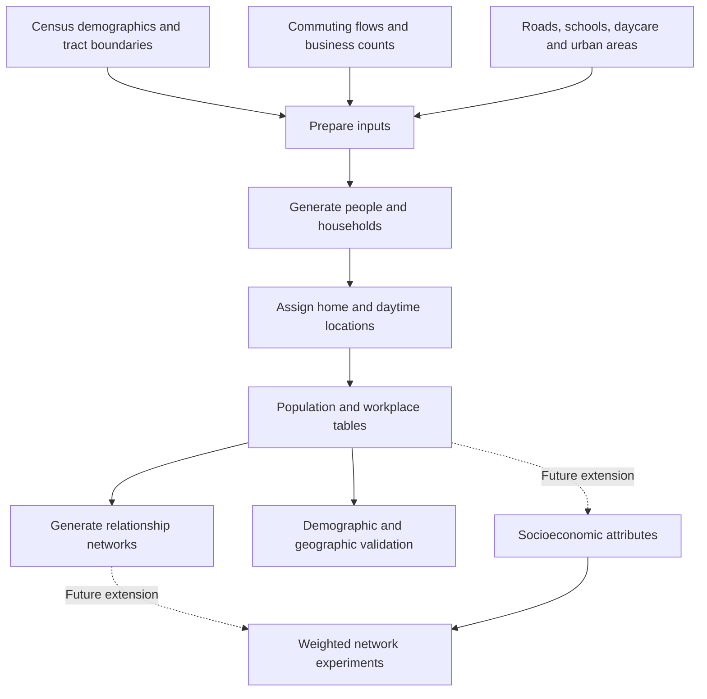

# Large-Scale Geographically Explicit Synthetic Population with Social Bonds Estimations for the United States

Python 3.12 research code for constructing a synthetic population for the 50 US states and Washington, D.C., with geographically located households and modeled household, workplace, school, and daycare connections.

A **synthetic population** consists of artificial people assembled to approximate demographic statistics. Individual people, home locations, household memberships, and social ties are generated; they are not identified residents or observed friendship records.

- **Original study:** [Scientific Data article](https://www.nature.com/articles/s41597-024-03970-1).
- **Published outputs:** [Synthetic Population Resulting Datasets on OSF](https://osf.io/fpnc2/). The original repository reports 85 GB uncompressed nationally, with outputs available by state. Confirm the current files, sizes, and release documentation before downloading.
- **This fork's research direction:** use Utah as a pilot, then investigate socioeconomic attributes and weighted relationships for network and mobility research. Those extensions are not implemented by the existing population and network generators.

This guide describes the behavior of the checked-in code. Implementation choices below should not be read as independently verified claims about the paper or every published dataset release.

## Contents

- [Workflow and repository map](#workflow-and-repository-map)
- [Population synthesis and output fields](#population-synthesis-and-output-fields)
- [How households are constructed](#how-households-are-constructed)
- [How social connections are generated](#how-social-connections-are-generated)
- [Data layout and execution requirements](#data-layout-and-execution-requirements)
- [Known handoff and execution gaps](#known-handoff-and-execution-gaps)
- [A Utah starting point](#a-utah-starting-point)
- [Research interpretation and future extensions](#research-interpretation-and-future-extensions)
- [License and attribution](#license-and-attribution)

## Workflow and repository map



| Location | Purpose | Main entry points |
| --- | --- | --- |
| [`code/0-preprocess/`](code/0-preprocess/) | Prepare census boundaries and demographic tables, roads, commuting flows, and workplace counts. Some inputs must be supplied separately. | `prepare-census/`, `prepare-road/`, `prepare-commute-data/` |
| [`code/1-population-synthesis/`](code/1-population-synthesis/) | Coordinate population generation by tract and state. | [`run-synthesis-by-state.py`](code/1-population-synthesis/run-synthesis-by-state.py) |
| [`code/2-social-networks/`](code/2-social-networks/) | Build household/education networks and collect workers for a national workplace network. | [`create_edu_hhold_get_work_pop.py`](code/2-social-networks/create_edu_hhold_get_work_pop.py), [`create_work_networks.py`](code/2-social-networks/create_work_networks.py) |
| [`code/3-validation/`](code/3-validation/) | Compare generated demographics, household characteristics, and geographic population counts with reference data. | `validation_population.py`, `validation_hhold.py`, and external validation scripts |
| [`src/`](src/) | Reusable functions called by the scripts above. | See the table below. |
| [`Figures/`](Figures/) | Original project illustrations. | `workflow.png`, `social_nw.png` |

The numbered folders indicate the intended processing stages. The current checkout has handoff gaps, so running every script in numerical order is not a verified end-to-end recipe.

## Population synthesis and output fields

The state driver loads prepared inputs, loops over populated census tracts, and calls `__synthesize__`. A **census tract** is a small geographic reporting area.

| Module | Responsibility |
| --- | --- |
| [`src/settings.py`](src/settings.py) | Data paths, state codes, and abbreviations. Utah is `49` / `UT`. |
| [`src/preprocess_data.py`](src/preprocess_data.py) | Download and preparation helpers, including commuting and workplace calculations. |
| [`src/ctreate_individuals.py`](src/ctreate_individuals.py) | Generate people from tract age/sex counts. The filename spelling is intentional here because it matches the checkout. |
| [`src/assign_household.py`](src/assign_household.py) | Allocate those people to household categories and group quarters. |
| [`src/create_space.py`](src/create_space.py) | Sample home and workplace points along selected roads intersecting the tract. These are generated locations, not verified addresses. |
| [`src/assign_workplace.py`](src/assign_workplace.py) | Use origin/destination commuting counts and synthetic workplace probabilities to assign adult workers. |
| [`src/assign_education_site.py`](src/assign_education_site.py) | Assign children to education sites using age eligibility, proximity, and input enrollment/count fields. |
| [`src/tools.py`](src/tools.py) | Collect outputs, flag urban residence, and perform tract-level checks. |
| [`src/create_social_networks.py`](src/create_social_networks.py) | Generate edges between people sharing a household or daytime location. |
| [`src/verification.py`](src/verification.py), [`src/after_validation_functions.py`](src/after_validation_functions.py), [`src/external_validation.py`](src/external_validation.py), [`src/bg_validate_functions.py`](src/bg_validate_functions.py) | Support demographic, household, and external comparisons. |

Age generation splits each five-year age group approximately evenly across individual ages, placing remainders at the upper age. The last group is generated as ages 85–89. The `gender` column stores the code's `m`/`f` census sex categories; it does not model gender identity.

Some census helpers select columns by position rather than field name. Preparing a table with the correct fields in a different order can therefore change its interpretation; inspect the expected order before supplying replacement inputs.

The population table connects later stages through these fields:

| Field | Meaning |
| --- | --- |
| `id` | Synthetic person identifier, generated from the home tract identifier and an individual suffix. |
| `age`, `gender` | Generated demographic attributes. |
| `hhold` | Household identifier, shared by household members. |
| `htype` | Numeric household category; see below. |
| `wp` | Daytime-location identifier: a workplace, school, daycare, or household fallback. It is not always a workplace. |
| `geometry`, `long`, `lat` | Generated home point and coordinates. |
| `urban` | Urban-area indicator. |

The current generators do not assign household income, wealth, or observed mobility histories.

## How households are constructed

Household construction is a sequence of rules and random selections within each tract. It starts with already-generated people and aggregate household counts. It does not recover real families or directly fit a complete joint distribution of household size, relationships, and socioeconomic status.

### 1. Calculate target numbers of household categories

`__get_hhold_type__` uses the following 2020 demographic-profile fields. Categories are described according to their interpretation in this code; check source-table metadata when preparing new inputs.

| `htype` | Category used by the code | Target count |
| --- | --- | --- |
| 0 | Married couple without children | `DP1_0133C - DP1_0134C` |
| 1 | Married couple with children | `DP1_0134C` |
| 2 | Cohabiting couple without children | `DP1_0135C - DP1_0136C` |
| 3 | Cohabiting couple with children | `DP1_0136C` |
| 4 | Male living alone, under 65 | `DP1_0138C - DP1_0139C` |
| 5 | Male living alone, 65 or older | `DP1_0139C` |
| 6 | Male householder with children | `DP1_0140C` |
| 7 | Female living alone, under 65 | `DP1_0142C - DP1_0143C` |
| 8 | Female living alone, 65 or older | `DP1_0143C` |
| 9 | Female householder with children | `DP1_0144C` |
| 10 | Remaining non-family group category | `(DP1_0137C - DP1_0138C - DP1_0140C) + (DP1_0141C - DP1_0142C - DP1_0144C)` |

For example, if a tract has 100 married-couple households and 40 in the with-children category, the targets are 60 type-0 households and 40 type-1 households. These are household counts, not counts of people.

### 2. Create household slots and allocate members in order

`__creat_hhold_id__` creates the requested slots, with IDs such as `<tract>h0`, and orders them as:

```text
4, 5, 7, 8, 0, 1, 2, 3, 9, 10, 6
```

Thus living-alone households are filled first. Later categories draw from the remaining people. An `assigned` flag tracks people selected so far; this ordering can affect which candidates remain available.

`__htype_find_members__` applies these rules:

- **Living alone:** choose an unassigned person matching the category's sex and age range (18–64 or 65+).
- **Couples:** choose an unassigned male aged at least 20, then an unassigned female partner. For a male aged 20–25, the partner range is 18 through his age plus 15. Otherwise it is his age minus 5 through his age plus 15, with a broader female-adult fallback if that range is empty. Same-sex couples are not represented by this pairing rule.
- **Couples with children:** request `max(1, abs(int(Normal(2, 1))))` children. Here `Normal(mean, standard_deviation)` is a random draw; truncation, absolute value, and the minimum mean the final count does not itself have mean exactly 2.
- **Male/female householders with children:** choose a matching adult aged at least 18 and request children with `max(1, abs(int(Normal(1.6, 1))))`.
- **Child ages:** eligible ages run from 0 through `min(18, youngest_selected_parent_age - 18)`. The upper bound is inclusive. If there are too few eligible children, the helper falls back to unassigned adults rather than guaranteeing the requested parent/child composition.
- **Non-family groups:** choose an adult and request additional members using `max(1, abs(int(Normal(1.5, 1))))`, with an age window around that adult. These ranges and counts are modeling choices, not household relationships observed in the data.

### 3. Allocate group quarters

**Group quarters** are communal living arrangements, such as dormitories or institutions. `__get_group_quarter__` uses sex-specific institutionalized and non-institutionalized counts after regular household allocation. Its initial age windows are 18–64 and 18–100 respectively, with broader same-sex fallback pools.

The code gives these groups a shared tract-level household ID and `htype=11`; it does not reconstruct separate facilities. A tract with zero regular households follows a special group-quarters branch that attempts to assign everyone to that shared ID.

### 4. Place remaining people

`__assign_left_pop_hhold__` assigns remaining people using weights **per eligible household**, normalized over the available slots:

| Remaining person's age | Eligible household types | Relative weights per household |
| --- | --- | --- |
| Under 18 | 1, 3, 6, 9; fallback to 10 if none exist | 0.45 for 1/3; 0.1 for 6/9 |
| Exactly 18 | 1, 3, 10 | 0.2 for 1/3; 0.6 for 10 |
| Over 18 | 0, 1, 2, 3, 10 | 0.1 for 0/1/2/3; 0.6 for 10 |

These are not fixed percentages of people assigned to each category: the number of eligible households also affects the probabilities. Adding leftovers can change household sizes and composition after initial member selection.

The resulting `hhold` identifier records co-residence. It does not provide explicit parent/child or spouse identifiers for later intergenerational analysis.

### What to validate

Target household slots do not guarantee that every slot is populated or every category has its intended composition. Candidate shortages can leave empty selections or cause sampling failures. The synthesis driver catches tract exceptions, so completion and saved outputs must be checked against the error log and expected tract coverage.

For a Utah pilot, inspect realized household sizes, ages and relationships, assignment completeness, group-quarters treatment, and agreement with independent reference counts. Household size directly affects how many network connections can be generated, making these assumptions relevant to inequality experiments.

## How social connections are generated

A **node** represents a person; an **edge** represents a modeled connection. `create_network` groups people by `hhold` for household relationships and by `wp` for workplace, school, and daycare relationships.

The same `create_edges` rule applies to every group, including households:

- **At most five people:** use a complete graph, connecting every pair.
- **More than five:** use `networkx.newman_watts_strogatz_graph(n, 4, 0.3)`, a ring with four initial neighbors per person plus randomly added shortcuts. The `0.3` parameter is not an all-pairs friendship probability.

Graphs are undirected and carry no explicit edge weights. Population IDs become graph node IDs. A household of six is therefore not treated as a complete graph merely because it is a household.

`create_networks_types` writes separate household, school, and daycare files. The national work driver combines workers across states before grouping by workplace; a network restricted to Utah residents would omit some out-of-state coworkers.

`to_csv` writes a headerless **adjacency list**: each row contains one person ID followed by neighboring IDs. Undirected relationships ordinarily appear from both endpoints. This is not a table with one `source,target,weight` record per edge, and it does not retain weights or relationship labels within each row.

The education assignment code attempts to assign all ages 0–4 to daycare and ages 5–17 to school. School/daycare assignments and within-site connections are model assumptions, not observed enrollment and friendship histories.

## Data layout and execution requirements

The data are distributed separately from this checkout. Paths in [`src/settings.py`](src/settings.py) are relative to the process's working directory; some drivers instead hardcode `../../data/...`.

```text
data/
  raw-data/          # Original census, commuting and other source inputs
  interim-data/      # Intermediate preparation outputs
  processed-data/   # Inputs consumed by population synthesis
    census/
    od/
    road/
    edu/
    urban/
    us_tract_number_work.json
  results-data/     # Generated population, workplace and network outputs
    ut/
    1-us/           # National worker table and work network
```

For Utah, the synthesis driver expects these names; they are **code expectations, not a verified OSF file inventory**:

```text
data/processed-data/census/ut-tracts-demo-work.shp.zip
data/processed-data/od/ut-tract-od-2020.csv
data/processed-data/road/UT_road_cleaned.shp.zip
data/processed-data/edu/ut_school_id.gpkg
data/processed-data/edu/ut_daycare_id.gpkg
data/processed-data/urban/UT_urban.gpkg
data/processed-data/us_tract_number_work.json
```

The JSON supplies national destination-tract workplace metadata, including `GEOID`, `WP_CNT`, and `WP_PROBA`, which support cross-tract and cross-state work assignments.

The Python target is 3.12. Dependencies are listed in [`requirements.txt`](requirements.txt), including GeoPandas, pandas, NumPy, NetworkX, and Jupyter. The checkout has no `pyproject.toml` or `setup.py`, although the requirements file contains `-e .` (an editable local-package installation). Install external requirements separately and make the repository root importable as `src`, for example through `PYTHONPATH`, until packaging is addressed. Use a separate virtual environment, a directory containing this project's installed Python packages.

The synthesis and social-network drivers resolve `../../data` as intended when run from their respective `code/1-population-synthesis/` and `code/2-social-networks/` directories, with the repository root on `PYTHONPATH`. Inspect each preprocessing script's paths individually before running it. Drivers generally loop over all configured states; there is no implemented `--state UT` command-line option.

During cloud setup, the Notebook 6.5.6 pin required `pyzmq<25`, whose source build failed on the available Python 3.12/compiler combination. A local installation override to Notebook 6.5.7 allowed current ZeroMQ wheels and passed notebook startup and kernel checks. That override is an environment workaround; it has not changed this repository's requirements file.

## Known handoff and execution gaps

| Area | Behavior in this checkout | Consequence |
| --- | --- | --- |
| Population format | Synthesis writes `<state>_population.gpkg`; a CSV is written only in its missing-ID/location branch. The household/education network driver reads `<state>_population.pickle`. | The output and reader do not connect directly. Inspect the supplied release and adapt loading or explicitly convert while preserving IDs, fields, and geographic metadata. Renaming a file extension is not conversion. |
| File meaning | GeoPackage is a geographic database format; Pickle serializes Python objects. | Both can hold population data, but require different readers. Pickle also depends on Python library compatibility; load only trusted files. |
| External validation | Two scripts import `RESULTS_DIR`, absent from `src/settings.py`. | Those scripts need a path/configuration correction before use. |
| Road preparation | The downloader imports `download_and_prepare_road_data`, while the helper is named `richard_download_and_prepare_road_data`; GRASS cleanup hardcodes a macOS executable. | Raw-road preparation needs separate fixes or suitable prepared inputs. |
| Census preparation | A joined path starts with `/census/`, discarding its configured parent directory. | Check and correct path handling before reproducing raw preprocessing. |
| Download verification | The LODES helper explicitly requests downloads with TLS certificate verification disabled. | Correct this behavior before using that download route; keep certificate verification enabled. |
| Reproducibility | The state driver seeds Python's `random`, but does not seed NumPy's generator; the graph helper receives no explicit seed. | A single apparent seed does not fully specify a reproducible population/network run. Record and control all randomness in an experiment runner. |

No full state synthesis or published Utah-data handoff has been validated in this documentation change. Small functional checks during environment setup exercised core demographic, geographic, and network functions; they do not establish end-to-end readiness or statistical realism.

## A Utah starting point

1. **Inventory the published Utah release.** Record source/release, filenames, formats, sizes, fields, reference years, and any supplied network files. Preserve the original downloads.
2. **Resolve the population reader.** Check that `id`, `age`, `hhold`, and `wp` are available and preserve identifier strings. Inspect geographic metadata before spatial joins.
3. **Build a small baseline.** Use complete households in a manageable geographic area. Keep relationship types separate and report connections excluded at geographic boundaries.
4. **Validate before scaling.** Check unique person IDs, complete assignments, household sizes, valid edge endpoints, isolated people, group sizes, and tract coverage. Define whether a Utah network includes only residents or also their outside contacts.
5. **Record a reproducible run.** Save input versions, code commit, parameters, seeds, and summary statistics. Existing output files are often treated as cached results; their presence alone does not establish they match new inputs or parameters.

Reusing a published population avoids rebuilding the raw-data pipeline just to begin network research. That population's format and assumptions still need to be checked against the intended experiment.

## Research interpretation and future extensions

Matching census demographics checks population construction. It does not independently validate modeled friendships, socioeconomic mixing, or observed mobility. These require additional evidence.

The planned sequence for this fork is:

1. Document and inspect the baseline, including household assumptions.
2. Evaluate network storage and computation using measured pilot sizes.
3. Add socioeconomic datasets with explicit geographic/year matching and uncertainty in assigned attributes.
4. Define weighted, potentially directed relationships and the lab's resource-transfer rules.

NetworkX is the current in-memory graph library; the existing persisted network format is adjacency-list CSV. Choosing storage, assigning meaningful relationship weights, and defining a resource-transfer matrix are separate decisions. A stronger tie need not automatically mean a larger resource transfer. Any weights, directions, normalization, and retained resources must be documented and tested against the lab's current mathematics.

## License and attribution

See [LICENSE](LICENSE) for CC0 1.0 Universal. Cite the original study and the dataset releases used in research. Additional datasets may have separate license and attribution requirements.

<a rel="license" href="https://creativecommons.org/publicdomain/zero/1.0/"></a>
