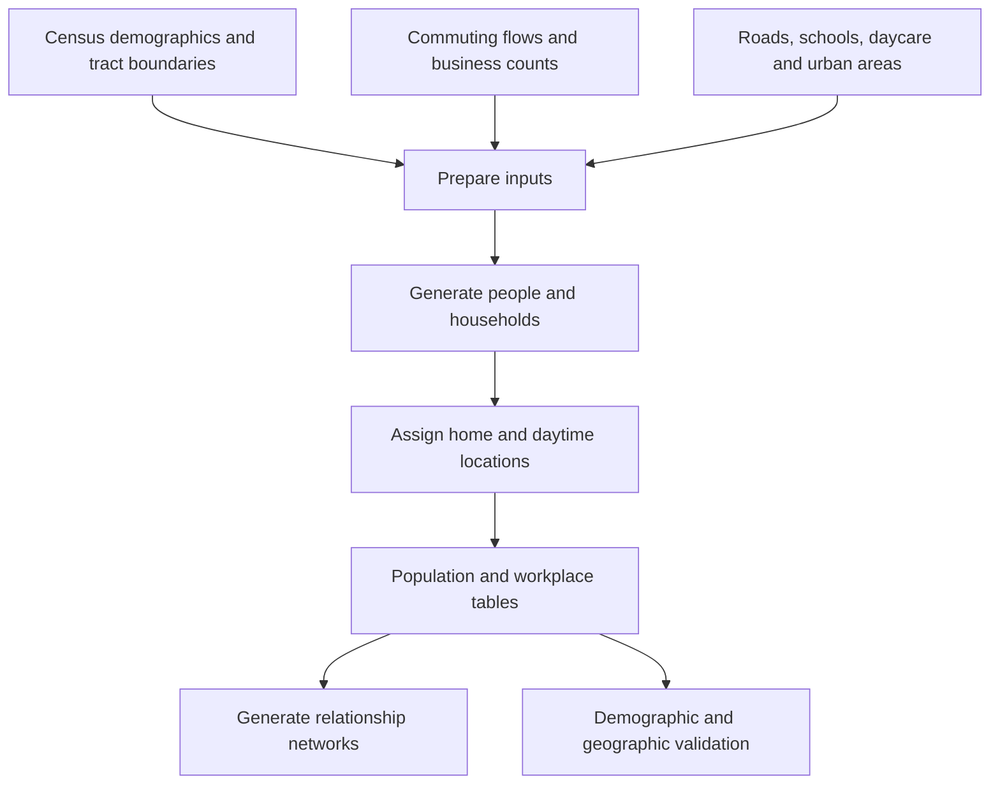

# Large-Scale Geographically Explicit Synthetic Population with Social Bonds Estimations for the United States

Python 3.12 research code for constructing a synthetic population for the 50 US states and Washington, D.C., with geographically located households and modeled household, workplace, school, and daycare connections.

A **synthetic population** consists of artificial people assembled to approximate demographic statistics. Individual people, home locations, household memberships, and social ties are generated; they are not identified residents or observed friendship records.

- **Original study:** [Scientific Data article](https://www.nature.com/articles/s41597-024-03970-1).
- **Published outputs:** [Synthetic Population Resulting Datasets on OSF](https://osf.io/fpnc2/). The original repository reports 85 GB uncompressed nationally, with outputs available by state. Confirm the current files, sizes, and release documentation before downloading.
- **This fork's scope:** improve documentation of the existing repository, its data flow, and its modeling assumptions. State-specific research extensions belong in a separate fork.

This guide describes the source files currently stored in this Git repository. Implementation choices below should not be read as independently verified claims about the paper or every published dataset release.

## Contents

- [Workflow and repository map](#workflow-and-repository-map)
- [Population synthesis and output fields](#population-synthesis-and-output-fields)
- [How employment information is compiled](#how-employment-information-is-compiled)
- [How school and childcare information is processed](#how-school-and-childcare-information-is-processed)
- [How households are constructed](#how-households-are-constructed)
- [How homes and workplaces are placed on roads](#how-homes-and-workplaces-are-placed-on-roads)
- [How social connections are generated](#how-social-connections-are-generated)
- [Data layout and execution requirements](#data-layout-and-execution-requirements)
- [Known handoff and execution gaps](#known-handoff-and-execution-gaps)
- [License and attribution](#license-and-attribution)

## Workflow and repository map



| Location | Purpose | Main entry points |
| --- | --- | --- |
| [`code/0-preprocess/`](code/0-preprocess/) | Prepare census boundaries and demographic tables, roads, commuting flows, and workplace counts. Some inputs must be supplied separately. | `prepare-census/`, `prepare-road/`, `prepare-commute-data/` |
| [`code/1-population-synthesis/`](code/1-population-synthesis/) | Coordinate population generation by tract and state. | [`run-synthesis-by-state.py`](code/1-population-synthesis/run-synthesis-by-state.py) |
| [`code/2-social-networks/`](code/2-social-networks/) | Build household/education networks and collect workers for a national workplace network. | [`create_edu_hhold_get_work_pop.py`](code/2-social-networks/create_edu_hhold_get_work_pop.py), [`create_work_networks.py`](code/2-social-networks/create_work_networks.py) |
| [`code/3-validation/`](code/3-validation/) | Compare generated demographics, household characteristics, and geographic population counts with reference data. | `validation_population.py`, `validation_hhold.py`, and external validation scripts |
| [`src/`](src/) | Reusable functions called by the scripts above. | See the table below. |
| [`Figures/`](Figures/) | Original project illustrations. | `workflow.png`, `social_nw.png` |

The numbered folders indicate the intended processing stages. The current checkout has handoff gaps, so running every script in numerical order is not a verified end-to-end recipe.

## Population synthesis and output fields

The state driver loads prepared inputs, loops over populated census tracts, and calls `__synthesize__`. A **census tract** is a relatively permanent statistical subdivision of a county, defined for reporting population and housing data. Tracts typically contain 1,200–8,000 residents, with a target of about 4,000; their land area varies widely. They do not necessarily follow neighborhood or city boundaries, and some have few or no residents. Each tract contains smaller geographic units called **census blocks**. A tract's full geographic identifier has 11 digits: two for the state, three for the county, and six for the tract. Preserve leading zeros when storing these identifiers.

| Module | Responsibility |
| --- | --- |
| [`src/settings.py`](src/settings.py) | Data paths and 51 state/DC code-to-abbreviation mappings. Numeric codes are nonconsecutive identifiers, not entry counts. |
| [`src/preprocess_data.py`](src/preprocess_data.py) | Download and preparation helpers, including commuting and workplace calculations. |
| [`src/ctreate_individuals.py`](src/ctreate_individuals.py) | Generate people from tract age/sex counts. |
| [`src/assign_household.py`](src/assign_household.py) | Allocate those people to household categories and group quarters. |
| [`src/create_space.py`](src/create_space.py) | Generate home and workplace coordinates. See the shared [road-placement section below](#how-homes-and-workplaces-are-placed-on-roads). |
| [`src/assign_workplace.py`](src/assign_workplace.py) | Assign adult workers using counts of jobs linking home tracts to work tracts and probabilities for synthetic workplaces. See the [employment section below](#how-employment-information-is-compiled). |
| [`src/assign_education_site.py`](src/assign_education_site.py) | Assign children to schools or daycare using age, proximity, and a comparison between supplied site counts and enrollment. See the education section below. |
| [`src/tools.py`](src/tools.py) | Collect outputs, flag urban residence, and perform tract-level checks. |
| [`src/create_social_networks.py`](src/create_social_networks.py) | Generate edges between people sharing a household or daytime location. |
| [`src/verification.py`](src/verification.py), [`src/after_validation_functions.py`](src/after_validation_functions.py), [`src/external_validation.py`](src/external_validation.py), [`src/bg_validate_functions.py`](src/bg_validate_functions.py) | Support demographic, household, and external comparisons. |

Age generation splits each five-year age group approximately evenly across individual ages, placing remainders at the upper age. The final input age category is **85 years and over**, but the code handles it like another five-year interval: `base_age = (code % 18) * 5` gives 85 for the last group, and its age offsets run only from 0 through 4. It therefore assigns this entire category to ages **85–89**, generating no ages 90+. The category's population count is retained, but the oldest residents' ages are compressed into that interval; this is an implementation limitation, not evidence that the source population has no residents over 89. The code does not document a scientific justification for that upper-age treatment.

The `gender` column stores the code's `m`/`f` census sex categories; it does not model gender identity.

Some census helpers select columns by position rather than field name. Preparing a table with the correct fields in a different order can therefore change its interpretation; inspect the expected order before supplying replacement inputs.

The population table connects later stages through these fields:

| Field | Meaning |
| --- | --- |
| `id` | Synthetic person identifier, generated from the home tract identifier and an individual suffix. |
| `age`, `gender` | Generated demographic attributes. |
| `hhold` | Household identifier, shared by household members. |
| `htype` | Numeric household category; see below. |
| `wp` | Daytime-location identifier: a workplace, school, daycare, or household fallback. It is not always a workplace. |
| `geometry` | A geographic point object representing the generated home location, used for operations such as checking which area contains a home or measuring spatial relationships. Its interpretation depends on the table's coordinate reference system (the convention defining coordinate units and placement on Earth). |
| `long`, `lat` | Numeric longitude and latitude columns copied from that point's `x` and `y` coordinates. For a home near Provo, an illustrative point is `POINT (-111.66 40.23)`, with `long=-111.66` and `lat=40.23`. These are another representation of the same location, not additional locations. |
| `urban` | Urban-area indicator. |

The current generators do not assign household income, wealth, or observed mobility histories.

When collecting results, `__collect_results__` labels the geographic table as `EPSG:4269` (NAD83 longitude/latitude) and copies `geometry.x`/`geometry.y` into `long`/`lat`. Labeling a coordinate system is not a coordinate transformation: input coordinates must actually match that system. If geometry is later transformed to another system, the separate numeric columns must also be refreshed if they are meant to describe its current coordinates.

`state_codes` and `state_dict` each contain **51 entries: 50 states plus Washington, D.C.** Their numeric keys are Federal Information Processing Standards (FIPS) geographic identifiers. They are not consecutive: for example, Wisconsin is `55` and Wyoming is `56`, while `03` is absent. A code's value does not tell you how many states are listed; these mappings do not include US territories.

## How employment information is compiled

### 1. Compile commuting counts

[`process_lodes8.py`](code/0-preprocess/prepare-commute-data/process_lodes8.py) calls helpers in `src/preprocess_data.py` to download 2020 **LODES** (LEHD Origin-Destination Employment Statistics) files for job type `JT00` (all jobs). **Origin** means where a worker lives; **destination** means where their job is located.

The original LODES files describe **pairs of census blocks, not already-aggregated census tracts**. Each data row identifies a home block (`h_geocode`), a work block (`w_geocode`), and counts of jobs connecting that particular pair. It does not identify individual workers or describe their travel route. `S000` (the letter S followed by three zeros) is the **total number of jobs for the selected job type and home/work block pair**, before breakdowns such as age or earnings categories. With `JT00`, these are all jobs, not necessarily unique employed people: a person can hold multiple jobs.

The downloader explicitly loops over the file types `main` and `aux`:

| File type | Contents, relative to the state where jobs are located | Example filename requested by the code |
| --- | --- | --- |
| `main` | Home and work blocks are in the same state. | `ut_od_main_JT00_2020.csv.gz` |
| `aux` | Work blocks are in that state, but home blocks are in another state. | `ut_od_aux_JT00_2020.csv.gz` |

These are **external data downloads, not files supplied in the Git repository**. The helper constructs their names in `download_lodes_2020_data` and writes them under `data/raw-data/work_commute/` with the default paths. No downloaded `aux` files are present in this checkout, and current upstream availability has not been verified here. The filename component `od` is the source's shorthand for origin/destination. A state's `aux` file describes incoming cross-state workers; it is not a complete list of that state's residents working elsewhere.

`combine_in_out_county_data` then:

1. Reads the matching downloaded compressed CSV files and combines their rows.
2. Derives each home/work **tract** identifier from its block identifier. In properly zero-padded identifiers, the first 11 of a block's 15 digits identify the tract; the final four identify the block within it. The existing code has special handling for state prefixes whose leading zero was lost, so identifier formatting needs care.
3. Groups all rows sharing a home tract and work tract, and sums their `S000` counts. Several block-to-block records can therefore contribute to one tract-to-tract record.
4. Writes `<state>-tract-od-2020.csv` under `interim-data/od`, containing `home`, `work`, and the summed `S000`. Despite the helper's name, this output is grouped by tract, not county.

For example, the **combined output table** might contain the following records. A, B, and C stand in for actual tract identifiers:

| `home` | `work` | `S000` | Meaning of this row |
| --- | --- | --- | --- |
| A | B | 100 | Across all contributing block pairs, 100 jobs have workers living in tract A and job locations in tract B. |
| A | C | 40 | Another 40 jobs link homes in tract A to job locations in tract C. |

The synthetic assignment function looks up rows with `home=A` and uses these destination counts to assign jobs toward B and C. A table row is an aggregate count of home-to-work connections, not one person's commute or a social edge. Job counts, numbers of business establishments, and numbers of synthetic people must be distinguished.

### 2. Estimate how many workplaces belong in each tract

[`process_cbp.py`](code/0-preprocess/prepare-commute-data/process_cbp.py) reads a separately supplied 2020 **County Business Patterns (CBP)** CSV. It selects all-establishment-size, all-industry rows and extracts county identifiers and `ESTAB`, the number of business establishments. It saves `interim-data/cbp/workplace_cbp.csv` under the configured data root.

[`add_tract_workplaces.py`](code/0-preprocess/prepare-commute-data/add_tract_workplaces.py) combines that table with commuting totals and tract geography. The intended allocation is:

```text
tract workplace count = integer part of (
    county establishment count × tract jobs / county jobs
)
```

The resulting `WP_CNT` is a modeled number of workplaces, not a count of workers or a list of actual firms. There is an implementation discrepancy: `get_number_of_wp` takes the first county job total from its grouped table rather than selecting the current tract's county total. This calculation needs correction or validation before treating its estimates as county-proportional allocations.

### 3. Assign synthetic adults to jobs and workplaces

`__assign_workplaces__` selects the commuting rows for a person's home tract and uses the destination counts to allocate jobs among synthetic residents aged 18+. If there are more jobs than available adults, it samples destinations for all adults; otherwise it randomly selects enough adults to fill the available counts. It does not assign employment using each person's observed occupation, income, or labor-force status.

`generate_workplace_id` then selects a synthetic workplace in the destination tract using the national JSON's `WP_CNT` and `WP_PROBA` (workplace-selection probabilities). IDs have the form `<destination-tract>w<workplace-number>`. Missing/zero workplace metadata produces `wNotFound` or `wNone` suffixes, which need to be checked before network construction.

Assigning a worker's workplace ID and generating that workplace's coordinates are separate operations. The shared [road-placement section](#how-homes-and-workplaces-are-placed-on-roads) explains the latter; the rules above determine job assignments, not street addresses.

`src/tools.py::wp_proba` provides a helper that draws lognormal workplace weights and normalizes them to sum to one. However, the preprocessing drivers do not show a complete construction of the national `us_tract_number_work.json`, including its `WP_PROBA` values. Do not assume that loading this JSON reproduces its preparation. The synthesis driver also expects commuting files under `processed-data/od`, while the combining helper writes them under `interim-data/od`; that handoff must be resolved when reproducing preprocessing.

## How school and childcare information is processed

Schools and childcare use **separate input tables and age branches in the same assignment module**, [`src/assign_education_site.py`](src/assign_education_site.py). There is no separate childcare assignment script in this checkout.

### Inputs and preparation

The state driver loads `<state>_school_id.gpkg` and `<state>_daycare_id.gpkg`. These are already-prepared geographic tables; the checkout does not contain a complete download/clean/build pipeline or verified source documentation for them.

| Input field | How the assignment code uses it |
| --- | --- |
| `eduID` | Identifier copied into a child's `wp` field. |
| `geometry` | Site location used to search around the home tract. |
| `LATITUDE`, `LONGITUDE` | Site coordinates used to rank candidates by distance from the child's home. |
| `s_age`, `e_age` | Inclusive minimum and maximum ages accepted by a school. The daycare branch does not apply this filter. |
| `ENROLLMENT` | Supplied enrollment value used as an upper bound in the eligibility comparison. It is not verified building capacity. |
| `count` | Supplied count compared with `ENROLLMENT`; its initialization/provenance is not shown, and this assignment module does not increment it when placing a child. |

The school-age helpers in `src/preprocess_data.py` map school `LEVEL` to ages: Primary/Elementary 5–11, Middle 12–14, Secondary 12–17, High 15–17, and other levels 5–17. These helpers exist, but no complete preparation driver invoking them is supplied.

### Assignment behavior and limitations

1. Ages 5–17 are sent to the school branch; ages 0–4 to daycare. Universal attendance in those age ranges is a modeling assumption.
2. The code searches for sites intersecting a buffer around the **home tract polygon**, first `0.1`, then `0.9` coordinate units if no eligible sites were found. With longitude/latitude coordinates these are degrees, not meters; the distance comments in the source are inaccurate.
3. For schools, it also filters to `s_age <= child age <= e_age`. For daycare, it searches the separate daycare table without that age filter.
4. It ranks candidate sites by home-to-site distance and chooses the nearest site whose supplied `count < ENROLLMENT`. If none passes that comparison, it randomly selects a candidate, ignoring that limit. An empty final candidate set can cause a selection error.
5. The chosen `eduID` is written to `wp`. Later, the network helper groups children sharing that ID to generate school/daycare connections.

Because `count` is not updated by this module and the fallback ignores its comparison, the code does **not enforce a running enrollment capacity constraint**. It also does not implement school catchment boundaries, household childcare choices, or observed friendship assignment.

## How households are constructed

Household construction is a sequence of rules and random selections within each tract. It starts with already-generated people and aggregate household counts. It does not recover real families or directly fit a complete joint distribution of household size, relationships, and socioeconomic status.

### 1. Calculate target numbers of household categories

`__get_hhold_type__` reads columns from the **2020 Census Demographic Profile table DP1**. A name such as `DP1_0133C` is a source-table field identifier, not a tunable model parameter: `DP1` identifies the table, `0133` the item, and `C` a count field. In Python, `tract.DP1_0133C` retrieves that field's value for the current tract.

Fields such as `DP1_0113C` follow this naming convention:

| Part | Meaning |
| --- | --- |
| `DP1` | The Census Demographic Profile table containing the statistic. |
| `_0113` | The item identifier within that table; it is a lookup key, not the number of people or households. |
| `C` | A count, rather than a percentage. The category being counted depends on the item. |

The full identifier is the column name in the input data. Its human-readable definition comes from the [Census DP1 variable metadata](https://api.census.gov/data/2020/dec/dp/groups/DP1.json), a dictionary of column names and labels. The category column below explains the household categories used by the code, while the formula column preserves the original Census field names so the calculation can be traced back to its inputs.

The **target-count formula** column below explains how many household slots to create from those input counts. For example, the code interprets `DP1_0133C` as all married-couple households and `DP1_0134C` as the subset with children, so their difference supplies the without-children target. Categories are described according to their interpretation in this code; verify the full source-table labels and definitions when preparing replacement inputs.

| `htype` | Category used by the code | Target-count formula using DP1 input columns |
| --- | --- | --- |
| 0 | Married couple without children | `DP1_0133C - DP1_0134C` |
| 1 | Married couple with children | `DP1_0134C` |
| 2 | Cohabiting couple without children | `DP1_0135C - DP1_0136C` |
| 3 | Cohabiting couple with children | `DP1_0136C` |
| 4 | Male living alone, under 65 | `DP1_0138C - DP1_0139C` |
| 5 | Male living alone, 65 or older | `DP1_0139C` |
| 6 | Male householder with children | `DP1_0140C` |
| 7 | Female living alone, under 65 | `DP1_0142C - DP1_0143C` |
| 8 | Female living alone, 65 or older | `DP1_0143C` |
| 9 | Female householder with children | `DP1_0144C` |
| 10 | Remaining non-family group category | `(DP1_0137C - DP1_0138C - DP1_0140C) + (DP1_0141C - DP1_0142C - DP1_0144C)` |

For example, if a tract has 100 married-couple households and 40 in the with-children category, the targets are 60 type-0 households and 40 type-1 households. These are household counts, not counts of people.

### 2. Create household slots and allocate members in order

`__creat_hhold_id__` creates the requested slots, with IDs such as `<tract>h0`, and orders them as:

```text
4, 5, 7, 8, 0, 1, 2, 3, 9, 10, 6
```

Thus living-alone households are filled first. Later categories draw from the remaining people. An `assigned` flag tracks people selected so far; this ordering can affect which candidates remain available.

`__htype_find_members__` applies these rules:

- **Living alone:** choose an unassigned person matching the category's sex and age range (18–64 or 65+).
- **Couples:** choose an unassigned male aged at least 20, then an unassigned female partner. For a male aged 20–25, the partner range is 18 through his age plus 15. Otherwise it is his age minus 5 through his age plus 15, with a broader female-adult fallback if that range is empty. Same-sex couples are not represented by this pairing rule.
- **Couples with children:** request `max(1, abs(int(Normal(2, 1))))` children. Here `Normal(mean, standard_deviation)` is a random draw; truncation, absolute value, and the minimum mean the final count does not itself have mean exactly 2.
- **Male/female householders with children:** choose a matching adult aged at least 18 and request children with `max(1, abs(int(Normal(1.6, 1))))`.
- **Child ages:** eligible ages run from 0 through `min(18, youngest_selected_parent_age - 18)`. The upper bound is inclusive. If there are too few eligible children, the helper falls back to unassigned adults rather than guaranteeing the requested parent/child composition.
- **Non-family groups:** choose an adult and request additional members using `max(1, abs(int(Normal(1.5, 1))))`, with an age window around that adult. These ranges and counts are modeling choices, not household relationships observed in the data.

The child-count expression means:

1. `Normal(2, 1)`: draw a random number from a bell-shaped distribution centered at 2, with standard deviation 1 (the spread of the draws).
2. `int(...)`: discard its fractional part, moving toward zero.
3. `abs(...)`: make the integer nonnegative.
4. `max(1, ...)`: require at least one requested child for this with-children category.

Yes: the second argument in `Normal(2, 1)` is **standard deviation 1**, not variance. This notation summarizes the code's `np.random.normal(2)`, which supplies mean 2 and uses NumPy's default standard deviation of 1. It describes the initial random draw; the integer conversion, absolute value, and minimum then change its distribution.

For example, draws of `0.8`, `2.7`, and `3.4` request 1, 2, and 3 children respectively. **Two is not a maximum:** the expression has no fixed upper cap. The actual members can differ because of candidate shortages and later leftover assignments. The values 1.6 and 1.5 in the other rules change the center of the initial draw, not an upper limit.

The partner rule does **not require husbands to be older**. For example, a selected male aged 35 admits female candidates aged 30–50 before fallback, including older partners. It imposes an asymmetric age window and a male-first selection process; the resulting age-gap distribution also depends on available candidates. No study citation is attached to this partner-age rule in the code. A Census families link appears near child selection, but does not establish support for the partner rule. The rationale in the original paper has not been verified here.

### 3. Allocate group quarters

**Group quarters** are communal living arrangements, such as dormitories, nursing facilities, or correctional institutions. `__get_group_quarter__` is the Python helper that selects people for this category; the underscores are part of its name, not a mathematical operation.

The institutionalized and non-institutionalized **counts come from the 2020 Census DP1 tract data**, not from random draws. [`process_census_shp.py`](code/0-preprocess/prepare-census/process_census_shp.py) retains these columns from the input demographic-profile CSV and merges them with tract geography. Their counts are empirical inputs; choosing which synthetic people fill those counts is modeled. The initial age windows below are also code choices, not additional age breakdowns supplied by those four count fields.

After regular households have selected members, the group-quarters helper reads these four tract counts:

| DP1 column | Group interpreted by the code | Initial candidate ages |
| --- | --- | --- |
| `DP1_0127C` | Institutionalized males | 18–64 |
| `DP1_0128C` | Institutionalized females | 18–64 |
| `DP1_0130C` | Non-institutionalized males | 18–100 |
| `DP1_0131C` | Non-institutionalized females | 18–100 |

For each nonzero count, `__get_group_quarter_ids__` randomly selects that many remaining people matching the category's sex and initial age range, without reusing selected people. If that pool is too small, it tries all remaining people of the same sex regardless of age. If even that pool is too small, it returns an empty selection rather than a partial allocation.

The helper returns a table of selected member lists with a shared ID, `<tract>h<regular-household-count>`, and `htype=11`. Institutionalized and non-institutionalized selections therefore share one tract-level co-residence identifier; separate real facilities are not reconstructed. The main assignment function copies this ID/type to selected people. Unselected people proceed to the leftover rules below. A tract with zero regular households instead follows a special branch that attempts to assign everyone to the shared group-quarters ID.

### 4. Place remaining people

`__assign_left_pop_hhold__` assigns remaining people using weights **per eligible household**, normalized over the available slots:

| Remaining person's age | Eligible household types | Relative weights per household |
| --- | --- | --- |
| Under 18 | 1, 3, 6, 9; fallback to 10 if none exist | 0.45 for 1/3; 0.1 for 6/9 |
| Exactly 18 | 1, 3, 10 | 0.2 for 1/3; 0.6 for 10 |
| Over 18 | 0, 1, 2, 3, 10 | 0.1 for 0/1/2/3; 0.6 for 10 |

These are not fixed percentages of people assigned to each category: the number of eligible households also affects the probabilities. Adding leftovers can change household sizes and composition after initial member selection.

The resulting `hhold` identifier records co-residence. It does not provide explicit parent/child or spouse identifiers for later intergenerational analysis.

After membership is assigned, everyone sharing a household ID receives the same generated home point. See [road placement](#how-homes-and-workplaces-are-placed-on-roads) for how that point is selected; household composition and geographic placement are separate steps.

### What to validate

Target household slots do not guarantee that every slot is populated or every category has its intended composition. Candidate shortages can leave empty selections or cause sampling failures. The synthesis driver catches tract exceptions, so completion and saved outputs must be checked against the error log and expected tract coverage.

Inspect realized household sizes, ages and relationships, assignment completeness, group-quarters treatment, and agreement with independent reference counts. Household size directly affects how many network connections can be generated.

## How homes and workplaces are placed on roads

### Road data source and preparation

The road-download helper points to the **US Census Bureau's [2020 TIGER/Line All Roads files](https://www2.census.gov/geo/tiger/TIGER2020/ROADS/)**. These geographic files contain road-line geometry and attributes such as road identifiers and classification codes. They describe roads, not public-transit schedules or observed trips.

`richard_download_and_prepare_road_data` in [`src/preprocess_data.py`](src/preprocess_data.py) selects county ZIP files matching the state's geographic code, downloads them, and combines them into an intermediate state road file. [`clean_raod_with_grass.py`](code/0-preprocess/prepare-road/clean_raod_with_grass.py) specifies GRASS GIS cleaning operations to snap nearby vertices, split line crossings, remove duplicate features, and remove small angles. `process_interim_road_data` then packages the cleaned geometry, road identifiers (`LINEARID`), classification (`MTFCC`), and connected-component information as `<STATE>_road_cleaned.shp.zip` for synthesis. GRASS GIS is geographic-processing software; connected components identify groups of road segments connected to one another.

This is the source and intended preparation path visible in the code, not an independently verified provenance record for the published OSF road files. The execution gaps listed below still apply. The synthesis stage uses the prepared road lines to place synthetic locations; it does not calculate travel times, transit service availability, or observed commuting routes along them.

### Shared placement steps

Both location functions in [`src/create_space.py`](src/create_space.py) use the prepared road dataset and a tract polygon. They select roads intersecting that tract, clip them to its boundary, retain supported line geometries, and remove duplicate coordinate sequences after rounding coordinates to six decimal places. The input `MTFCC` field is the Census **MAF/TIGER Feature Class Code**, identifying the type of road.

### Road types and candidate locations

| Road code | Road category | Home candidates | Workplace candidates |
| --- | --- | --- | --- |
| `S1400` | Local neighborhood roads, rural roads, and city streets | Points sampled along the clipped road geometry. | The first coordinate of each clipped geometry. |
| `S1740` | Private roads for service vehicles, such as logging, oil-field, or ranch roads | Same treatment as `S1400`. | Same treatment as `S1400`. |
| `S1200` | Secondary roads | Not selected for homes. | Points sampled along the clipped road geometry. |
| `S1100` | Primary roads | Not selected. | Not selected by the implemented filter, despite comments mentioning primary roads. |

**Homes:** `__create_home_location__` generates candidate points at distance intervals of `0.0005` along the selected `S1400`/`S1740` geometries, starting at that interval and stopping before the geometry's end. It randomly samples from the pooled candidates. The state driver requests `DP1_0132C + 1` locations: one per regular household slot plus one for the tract's shared group-quarters ID. The returned points are indexed by household ID and mapped onto people's home `geometry` fields.

**Workplaces:** `__create_work_location__` generates candidates along `S1200` roads using intervals of `0.0002`, then adds the first coordinate from each selected `S1400`/`S1740` geometry. For a multi-part road, it uses the first coordinate of the first part. Although the variable is called `intersection_points`, the code does not calculate intersections between roads: these are geometry endpoints, which may also lie on the tract boundary after clipping. It samples `WP_CNT` points from the combined pool; local/private-road endpoints can supply locations when secondary-road candidates are unavailable. Points are indexed by workplace ID and saved in the workplace table, separate from people's home coordinates.

### Shared assumptions and limitations

- Both functions sample **with replacement**: distinct household or workplace IDs can receive identical coordinates. Household members share their household's point by design.
- Intervals are measured in the input coordinate system's units. With longitude/latitude data, `0.0005` and `0.0002` are degrees, not fixed distances in meters. The functions do not project roads into a distance-based coordinate system first.
- Sampling is uniform over pooled candidate points, not over road names, tracts, or parcels. Longer geometries generally contribute more interpolated candidates; workplaces also have the endpoint candidates described above.
- These are synthetic points on roads, not building entrances or observed residential/business addresses. The functions do not check zoning, building footprints, parcel use, or whether a private service road actually has housing.
- There is no general fallback to other road classes or arbitrary points inside the tract. If a function must generate locations but its candidate pool is empty, sampling can fail; inspect tract error logs and resulting coverage.

## How social connections are generated

A **node** is a person and an **edge** is a modeled connection. `create_network` groups people by `hhold` (households) or `wp` (work, school, daycare). The same rule applies to every group: connect every pair if it has at most five members; otherwise use `networkx.newman_watts_strogatz_graph(n, 4, 0.3)`, a ring with four initial neighbors per person and randomly added shortcuts.

Connections are undirected, with no explicit weights. Separate files hold household, school, and daycare networks; the work driver groups workers nationally, including cross-state coworkers. `to_csv` writes a headerless **adjacency list**: each row is a person ID followed by neighbor IDs. These connections are generated assumptions, not observed friendships.

## Data layout and execution requirements

The data are distributed separately from this checkout. Paths in [`src/settings.py`](src/settings.py) are relative to the process's working directory; some drivers instead hardcode `../../data/...`.

```text
data/
  raw-data/          # Original census, commuting and other source inputs
  interim-data/      # Intermediate preparation outputs
  processed-data/   # Inputs consumed by population synthesis
    census/
    od/
    road/
    edu/
    urban/
    us_tract_number_work.json
  results-data/     # Generated population, workplace and network outputs
    <state>/
    1-us/           # National worker table and work network
```

For each state, the synthesis driver expects the following names. Here `<state>` is its lowercase abbreviation and `<STATE>` its uppercase abbreviation. These are **code expectations, not a verified OSF file inventory**:

```text
data/processed-data/census/<state>-tracts-demo-work.shp.zip
data/processed-data/od/<state>-tract-od-2020.csv
data/processed-data/road/<STATE>_road_cleaned.shp.zip
data/processed-data/edu/<state>_school_id.gpkg
data/processed-data/edu/<state>_daycare_id.gpkg
data/processed-data/urban/<STATE>_urban.gpkg
data/processed-data/us_tract_number_work.json
```

The JSON supplies national destination-tract workplace metadata, including `GEOID`, `WP_CNT`, and `WP_PROBA`, which support cross-tract and cross-state work assignments.

The Python target is 3.12. Dependencies are listed in [`requirements.txt`](requirements.txt), including GeoPandas, pandas, NumPy, NetworkX, and Jupyter. The checkout has no `pyproject.toml` or `setup.py`, although the requirements file contains `-e .` (an editable local-package installation). Install external requirements separately and make the repository root importable as `src`, for example through `PYTHONPATH`, until packaging is addressed. Use a separate virtual environment, a directory containing this project's installed Python packages.

The synthesis and social-network drivers resolve `../../data` as intended when run from their respective `code/1-population-synthesis/` and `code/2-social-networks/` directories, with the repository root on `PYTHONPATH`. Inspect each preprocessing script's paths individually before running it. Drivers generally loop over all configured states; there is no implemented single-state command-line option.

The requirements now specify Notebook 6.5.7. During cloud setup, the former 6.5.6 pin required `pyzmq<25`, whose source build failed on the available Python 3.12/compiler combination. Notebook 6.5.7 allowed current ZeroMQ wheels and passed notebook startup and kernel checks. This resolves that specific dependency issue; the separate editable-package and data-pipeline gaps still apply.

## Known handoff and execution gaps

| Area | Behavior in this checkout | Consequence |
| --- | --- | --- |
| Population format | Synthesis writes `<state>_population.gpkg`; a CSV is written only in its missing-ID/location branch. The household/education network driver reads `<state>_population.pickle`. | The output and reader do not connect directly. Inspect the supplied release and adapt loading or explicitly convert while preserving IDs, fields, and geographic metadata. Renaming a file extension is not conversion. |
| File meaning | GeoPackage is a geographic database format; Pickle serializes Python objects. | Both can hold population data, but require different readers. Pickle also depends on Python library compatibility; load only trusted files. |
| External validation | Two scripts import `RESULTS_DIR`, absent from `src/settings.py`. | Those scripts need a path/configuration correction before use. |
| Road preparation | The downloader imports `download_and_prepare_road_data`, while the helper is named `richard_download_and_prepare_road_data`; GRASS cleanup hardcodes a macOS executable. | Raw-road preparation needs separate fixes or suitable prepared inputs. |
| Census preparation | A joined path starts with `/census/`, discarding its configured parent directory. | Check and correct path handling before reproducing raw preprocessing. |
| Download verification | The LODES helper explicitly requests downloads with TLS certificate verification disabled. | Correct this behavior before using that download route; keep certificate verification enabled. |
| Reproducibility | The state driver seeds Python's `random`, but does not seed NumPy's generator; the graph helper receives no explicit seed. | A single apparent seed does not fully specify a reproducible population/network run. Record and control all randomness in an experiment runner. |

No full state synthesis or published-data handoff has been validated in this documentation change. Small functional checks during environment setup exercised core demographic, geographic, and network functions; they do not establish end-to-end readiness or statistical realism.

## License and attribution

See [LICENSE](LICENSE) for CC0 1.0 Universal. Cite the original study and the dataset releases used in research. Additional datasets may have separate license and attribution requirements.

<a rel="license" href="https://creativecommons.org/publicdomain/zero/1.0/"></a>
