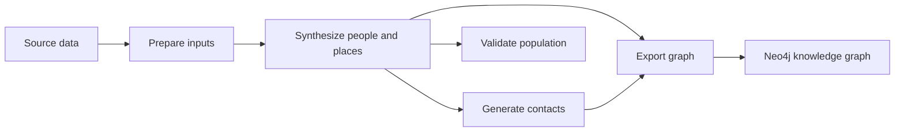

# Architecture

## Current flow

The numbered `code/` directories contain executable drivers. `src/` is the current importable package of shared functions. The package has not been renamed or reorganized. See the [pipeline guide](pipeline.md) for commands and the [data interfaces](input-data.md) for files passed between stages.

| Responsibility | Current location | Boundary |
| --- | --- | --- |
| Input preparation | `code/0-preprocess/`, `src/census_prep.py`, `src/clean_roads.py`, `src/preprocess_data.py` | Source downloads and transformations into synthesis inputs |
| Population synthesis | `code/1-population-synthesis/`, individual/household/work/education and spatial modules in `src/` | Generate people and assign households and places |
| Contacts | `code/2-social-networks/`, `src/create_social_networks.py` | Group people by assigned sites and generate modeled ties |
| Validation | `code/3-validation/`, validation helpers in `src/` | Compare generated demographics and spatial counts with reference data |
| Graph export | `code/4-knowledge-graph/` | Export generated people, places, and contacts for Neo4j |
| Shared execution support | `src/settings.py`, `src/cli.py`, `src/seeding.py`, `src/population_io.py`, `src/timing.py` | Paths, geographic selection, seeds, population reads, and diagnostics |
| Tests | `tests/` | Existing fixtures and checks for imports, handoffs, reproducibility, and component behavior |

The paper's generation steps and these directories use different numbering: paper Steps 1 and 2 both occur in population synthesis; paper Step 3 occurs in contact generation. Validation and export are additional repository stages.

Some responsibilities currently overlap. In particular, `src/tools.py` combines workplace probabilities, validation, result collection, and spatial helpers; `src/preprocess_data.py` combines multiple sources and transformations. The synthesis driver also contains processing logic. These responsibilities are currently shared rather than isolated into separate modules.
