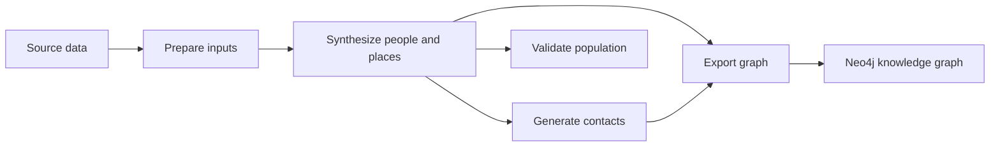

# Architecture

Code is organized by pipeline step under `pipeline/`. Each stage folder contains its commands and the modules that support that step. `src/` holds the support used across steps. Setuptools discovers the pipeline namespace package and the shared `src` package. Commands run with `python -m pipeline.<stage>.<module>` and use fully qualified imports without modifying Python's search path.

## Current flow

| Location | Responsibilities | Python imports |
| --- | --- | --- |
| `pipeline/preprocess/` | Downloads, Census joins, commuting/workplace preparation, road cleaning, and education inputs | `pipeline.preprocess.*` |
| `pipeline/population_synthesis/` | People, households, work/education assignments, spatial placement, per-tract verification, and population-location visualization | `pipeline.population_synthesis.*` |
| `pipeline/social_networks/` | Household, school, daycare, and workplace contacts | `pipeline.social_networks.*` |
| `pipeline/validation/` | Demographic, household, PUMS, and block-group comparisons and their plots | `pipeline.validation.*` |
| `pipeline/knowledge_graph/` | Neo4j export and graph summary scripts | `pipeline.knowledge_graph.*` |
| `src/` | Settings, command-line geography, seeds, and population-file reading | `src` |
| `tests/` | Component, import/packaging, file-handoff, and reproducibility checks | Test modules |

Preprocessing commands and helpers are grouped into `prepare_census`, `prepare_commute`, `prepare_roads`, and `prepare_education` subfolders. Census helpers live in `prepare_census/census_prep.py`; road inputs in `prepare_roads/road_inputs.py`; and commuting, business counts, and workplace estimates in `prepare_commute/lodes.py`, `cbp.py`, and `workplace_counts.py`. The small `_downloads.py` module is shared by road and commute preparation.

See the [pipeline guide](pipeline.md) for commands and [input data](input-data.md) for file handoffs.

## Imports and shared code

The project installs the `pipeline` and `src` packages. Run the stage modules with `python -m` as shown in the [pipeline guide](pipeline.md#setup). Fully qualified imports work without adding stage folders to `PYTHONPATH`.

Stage-specific helpers stay with their commands. Shared settings, geography options, seeds, and population reading live in `src/`. Population and household validation share table-building and plotting helpers; external comparisons remain separate.

The paper’s Steps 1 and 2 occur in population synthesis; Step 3 occurs in contact generation. Validation and export are additional repository stages.
