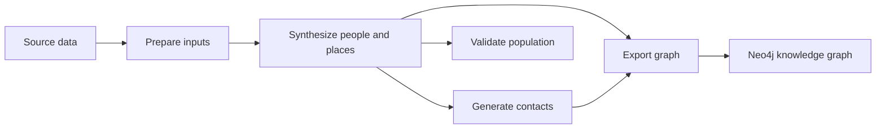

# Architecture

Code is organized by pipeline step. Each numbered folder contains its commands and the modules that support that step. `src/` holds the support used across steps.

## Current flow



| Location | Responsibilities | Python imports |
| --- | --- | --- |
| `code/0-preprocess/` | Downloads, Census joins, commuting/workplace preparation, road cleaning, and education inputs | Local modules |
| `code/1-population-synthesis/` | People, households, work/education assignments, spatial placement, per-tract verification, and population-location visualization | Local modules |
| `code/2-social-networks/` | Household, school, daycare, and workplace contacts | Local modules |
| `code/3-validation/` | Demographic, household, PUMS, and block-group comparisons and their plots | Local modules |
| `code/4-knowledge-graph/` | Neo4j export and graph summary scripts | Local modules |
| `src/` | Settings, command-line geography, seeds, and population-file reading | `src` |
| `tests/` | Component, import/packaging, file-handoff, and reproducibility checks | Test modules |

Preprocessing commands and helpers are grouped into `prepare_census`, `prepare_commute`, `prepare_roads`, and `prepare_education` subfolders. Census helpers live in `prepare_census/census_prep.py`; road inputs in `prepare_roads/road_inputs.py`; and commuting, business counts, and workplace estimates in `prepare_commute/lodes.py`, `cbp.py`, and `workplace_counts.py`. The small `_downloads.py` module is shared by road and commute preparation.

See the [pipeline guide](pipeline.md) for commands and [input data](input-data.md) for file handoffs.

## Imports and shared code

[pyproject.toml](../pyproject.toml) installs only the shared `src` package. The numbered stage folders stay as scripts and local modules, with no alternate package names. For example, the synthesis command imports its neighboring helper directly:

```python
from create_individuals import create_individuals
from src.load_synthesis_output import load_population
```

Run commands by file path as shown in the [setup and pipeline guide](pipeline.md#setup). Python finds neighboring stage modules beside the script. Preprocessing also needs `code/0-preprocess` on `PYTHONPATH` so its subfolders can share helpers, for example `from prepare_census.census_prep import census_demo_path`. Tests add the stage folders to their import path in `tests/conftest.py`. The wheel contains only `src`; running stages requires the checkout.

Small helpers with one production caller live in that caller: the education input script owns its school-age rules, and the workplace JSON script owns its probability helper. Substantial step-specific logic stays in a module beside the step's commands. Synthesis result assembly lives in `code/1-population-synthesis/results.py`; population reading shared by later steps lives in `../src/load_synthesis_output.py`.

Population and household validation share the table-building and plotting helpers in `code/3-validation/after_validation_functions.py`. External PUMS and block-group comparisons remain in separate modules. The standalone 3D population plotting module is available for manual exploration.

The paper's generation steps and these directories use different numbering: paper Steps 1 and 2 both occur in population synthesis; paper Step 3 occurs in contact generation. Validation and export are additional repository stages.
