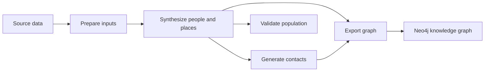

# Architecture

Code is organized by pipeline step. Each numbered folder contains its commands and the modules that support that step. `src/` holds the support used across steps.

## Current flow



| Location | Responsibilities | Python imports |
| --- | --- | --- |
| `code/0-preprocess/` | Downloads, Census joins, commuting/workplace preparation, road cleaning, and education inputs | `pipeline.preprocess` |
| `code/1-population-synthesis/` | People, households, work/education assignments, spatial placement, per-tract verification, and population-location visualization | `pipeline.population` |
| `code/2-social-networks/` | Household, school, daycare, and workplace contacts | `pipeline.networks` |
| `code/3-validation/` | Demographic, household, PUMS, and block-group comparisons and their plots | `pipeline.validation` |
| `code/4-knowledge-graph/` | Neo4j export and graph summary scripts | `pipeline.graph` |
| `src/` | Settings, command-line geography, seeds, timing, and population-file reading | `src` |
| `tests/` | Component, import/packaging, file-handoff, and reproducibility checks | Test modules |

The existing command paths are unchanged. For example, synthesis still runs through `code/1-population-synthesis/run-synthesis-by-state.py`. See the [pipeline guide](pipeline.md) for commands and [input data](input-data.md) for file handoffs.

## Imports and shared code

The package mapping in [pyproject.toml](../pyproject.toml) gives the numbered folders readable import names. For example:

```python
from pipeline.population.create_individuals import create_individuals
from pipeline.networks.create_social_networks import create_network
from src.population_io import load_population
```

Install or refresh the local package with `python -m pip install -e .` after changing this mapping. Scripts and tests then use the same imports from any working directory. The `pipeline` packages use implicit namespaces, so `code/` does not need an `__init__.py` that would shadow Python's standard-library `code` module. Import tests check both an editable checkout and a normal wheel build.

Small helpers with one production caller live in that caller: the education input script owns its school-age rules, and the workplace JSON script owns its probability helper. Substantial step-specific logic stays in a module beside the step's commands. Synthesis result assembly lives in `code/1-population-synthesis/results.py`; population reading shared by later steps lives in `src/population_io.py`.

Population and household validation share the table-building and plotting helpers in `code/3-validation/after_validation_functions.py`. External PUMS and block-group comparisons remain in separate modules. The standalone 3D population plotting module is available for manual exploration.

The paper's generation steps and these directories use different numbering: paper Steps 1 and 2 both occur in population synthesis; paper Step 3 occurs in contact generation. Validation and export are additional repository stages.
