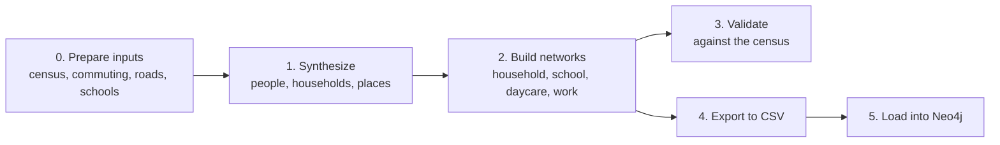

# Running the pipeline

This guide runs the whole pipeline for one area, from downloading public data to a Neo4j graph
you can query. The example is Salt Lake County, Utah (`--state ut --counties 035`). Drop
`--counties 035` to run all of Utah.



| Step | Time (Salt Lake County, M-series Mac) |
|---|---|
| 0. Prepare inputs | Mostly downloading. Roads: about 30 s download and 60 s cleaning |
| 1. Synthesize | About 32 minutes of compute (about 7.5 s per tract). All of Utah: an estimated 1.5–2 hours |
| 2. Networks | About 45 seconds |
| 3. Validate | About 20 seconds |
| 4–5. Neo4j | About 1 minute (export 22 s, import 20 s, tract layer 12 s) |

## Before you start

- **Python 3.12** and about 5 GB of free disk space for the data.
- **Internet access** for the downloads. A free [Census API key](https://api.census.gov/data/key_signup.html)
  in `CENSUS_API_KEY` is recommended. Without one, the census step uses data.census.gov's
  table endpoint.
- **For the graph:** [Neo4j Desktop 2](https://neo4j.com/download/) and the `neo4j-cli`
  command-line tool.
- **A machine that stays awake.** Sleep, including a closed laptop lid, pauses synthesis.
  On a Mac, keep it plugged in with the lid open and run long steps under `caffeinate -i`.

## Setup

```bash
python3.12 -m venv .venv
source .venv/bin/activate
pip install -r requirements.txt pytest     # also installs this repo as the `src` package
python -m pytest                           # about 1.5 minutes
```

All scripts find their data through `src/settings.py`. By default that is `<repo>/data/`, which
git ignores. To keep data elsewhere, set `GSPN_DATA_DIR` before running anything:

```bash
export GSPN_DATA_DIR=~/gspn-data
```

Don't put the data under `/tmp` or `/private/tmp`. macOS deletes old files there on its own,
and a run in this project lost its inputs that way.

## 0. Prepare inputs

These steps build state-wide inputs, even for a county run. Run them in this order, because
later steps read earlier outputs.

```bash
# Census: population tables (DP1), tract boundaries, urban areas
python code/0-preprocess/prepare-census/download_census_inputs.py --state ut

# Commuting: LODES home-to-work flows, then county business counts (all states, one file)
python code/0-preprocess/prepare-commute-data/process_lodes8.py --state ut
python code/0-preprocess/prepare-commute-data/process_cbp.py --download

# Census tracts joined with the commuting inputs (needs the two steps above)
python code/0-preprocess/prepare-census/process_census_shp.py --state ut

# Workplaces per tract and their size weights
python code/0-preprocess/prepare-commute-data/build_tract_workplace_json.py --state ut --seed 42

# Roads, then cleaning (replaces the original GRASS step)
python code/0-preprocess/prepare-road/download_process_roads.py --state ut
python code/0-preprocess/prepare-road/clean_roads.py --state ut

# Schools and daycares (EPA/ORNL 2015 layer)
python code/0-preprocess/prepare-edu/build_edu_sites.py --state ut --download
```

What comes out, under `data/processed-data/`: census tracts, the commuting table, the cleaned
roads, school and daycare sites, urban areas and `us_tract_number_work.json`. The README's
*Input paths* section lists the exact file names.

**Known issue:** `build_tract_workplace_json.py --seed` does not yet make the workplace size
weights repeatable (see [`open-decisions.md`](open-decisions.md), §1). Rebuilding this file
gives a slightly different population for the same seed. Keep the file if you need to repeat a
run exactly.

## 1. Synthesize the population

```bash
caffeinate -i python code/1-population-synthesis/run-synthesis-by-state.py --state ut --counties 035 --seed 42
```

Add `--dry-run` first to list the tracts it would process. Outputs go to
`data/results-data/ut/` and are named after the run: `ut_c035` for this county, `ut` for the
whole state.

- `ut_c035_population.gpkg` and `.csv`: one row per person with age, sex, household and home point
- `ut_c035_workplace.gpkg`: workplace points
- `ut_c035_error_log.csv`: tracts that failed. In Salt Lake County, one tract with 16 people
  (`49035980000`) fails. That's expected; see the changelog.

## 2. Build the social networks

```bash
python code/2-social-networks/create_edu_hhold_get_work_pop.py --state ut --counties 035 --seed 42
python code/2-social-networks/create_work_networks.py --state ut --counties 035 --seed 42
```

The first writes the household, school and daycare networks to
`data/results-data/ut/social_networks/`. The second writes the worker table and work network to
`data/results-data/1-us/`. A network step skips any file that already exists, so delete old
network files before rebuilding them.

## 3. Validate

```bash
python code/3-validation/validation_population.py --state ut --counties 035
python code/3-validation/validation_hhold.py --state ut --counties 035
python code/3-validation/validation_tract_avg_hhold.py --state ut --counties 035
```

These compare the synthetic population with the census by tract. For a good run:

- **Age and sex:** `ut_c035_age_verification.csv` totals equal the census for the tracts that
  ran (the `Good_Census_*` columns).
- **Household types:** `ut_c035_hhold_verification.csv` does the same for the 11 household
  types.
- **Household size:** in `ut_c035_avg_hhold_verification.csv`, large gaps usually mean group
  quarters, such as a dormitory, in that tract.

To check that a run is repeatable, run steps 1–3 twice into different `GSPN_DATA_DIR` copies of
the same inputs and compare the output files byte for byte (`cmp`). The Salt Lake runs matched
on all 18 files.

## 4. Export the run for Neo4j

```bash
python code/4-knowledge-graph/export_neo4j_csv.py --state ut --counties 035 --seed 42
```

This writes one CSV per node label and relationship type to `data/neo4j-import/ut_c035/`, plus
`import.args`, the argument file for the bulk importer. `--seed` is only recorded on the graph's
`Run` node. Pass the seed the run actually used.

## 5. Load into Neo4j

### Create an instance (once)

Create a DBMS in Neo4j Desktop (**Local instances → Create instance**), or with the CLI while
Desktop is open:

```bash
neo4j-cli desktop dbms create --name gspn --rw    # asks for a password
```

Save the connection settings in a file outside the repo, readable only by you, for example
`~/.config/gspn/neo4j.env`:

```text
NEO4J_URI=neo4j://localhost:7687
NEO4J_USERNAME=neo4j
NEO4J_PASSWORD=<your password>
```

After that, start and stop the instance from Desktop. If Desktop shows the instance as stopped
while port 7687 is still busy, an earlier start left a server running outside Desktop. Stop
that process (`lsof -nP -iTCP:7687` shows it) and start the instance from Desktop again.

### Import a run

Each run gets its own database. Neo4j database names can't contain underscores, so run
`ut_c035` becomes database `ut-c035`.

```bash
ENV=~/.config/gspn/neo4j.env
DBMS="<root_path from: neo4j-cli desktop dbms list>"
export JAVA_HOME="$HOME/Library/Application Support/neo4j-desktop/Application/Cache/runtime/<jre folder>/Contents/Home"

# Bulk import into a new database (the instance can stay running)
"$DBMS/bin/neo4j-admin" database import full ut-c035 @data/neo4j-import/ut_c035/import.args

# Register it, then add constraints and the tract summary layer
neo4j-cli query --env $ENV --database system --rw 'CREATE DATABASE `ut-c035` WAIT'
neo4j-cli query --env $ENV --database ut-c035 --rw "$(cat code/4-knowledge-graph/constraints.cypher)"
neo4j-cli query --env $ENV --database ut-c035 --rw "$(cat code/4-knowledge-graph/tract_summary.cypher)"
```

The import prints the node and relationship counts it created. They should equal the row counts
of the CSV files. For Salt Lake County that is 1,652,621 nodes and 6,305,346 relationships.

To replace a database, drop it first
(`neo4j-cli query --env $ENV --database system --rw 'DROP DATABASE `ut-c035`'`), then rerun the
import and the three queries.

### Use it

In Desktop, open the instance and pick `ut-c035` in the database list, or start a query with
``USE `ut-c035` ``. Queries against the default `neo4j` database find nothing. The graph model,
example queries and how to view the whole county at tract level are in
[`knowledge-graph.md`](knowledge-graph.md).

## Troubleshooting

| Symptom | Cause and fix |
|---|---|
| `process_census_shp.py` exits with code 3 | The commuting inputs are missing. Run `process_lodes8.py` and `process_cbp.py` first. |
| Synthesis takes hours | The machine slept. Keep it awake (see *Before you start*). |
| Network step finishes instantly with old results | A network file already exists and is not rebuilt. Delete it first. |
| A rerun's outputs differ from an earlier run | Different library versions (`requirements.txt` pins none) or a rebuilt `us_tract_number_work.json`. See [`open-decisions.md`](open-decisions.md). |
| `neo4j-admin` can't find Java | Set `JAVA_HOME` to the Java runtime Desktop downloaded, as above. |
| `neo4j-admin import` refuses to run | The database already exists. Drop it first. |
| Cypher warnings that `Person` or `MEMBER_OF` don't exist | The query ran against the default `neo4j` database. Switch to the run's database. |
| `neo4j-cli` says `this command writes; pass --rw` | It also flags some read-only admin commands, such as `SHOW DATABASES`. Add `--rw`. |
